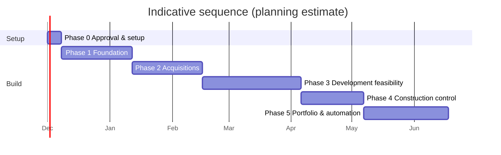

# MK.Buildings — AI Workforce Implementation Roadmap

| Item | Detail |
|---|---|
| Document | `docs/MK_BUILDINGS_AGENT_ROADMAP.md` |
| Blueprint | `docs/MK_BUILDINGS_AI_WORKFORCE_ARCHITECTURE.md` |
| Date | November 24, 2026 |
| Status | **Proposal — implementation starts only after Founder approval** |

Labels: **[R]** recommendation · **[A]** assumption · **[TBV]** to be verified. Durations are planning estimates **[A]**, not commitments; they depend on Founder availability, access to keys, and review cycles.

---

## 1. Roadmap principles

1. **Deliver a usable decision tool early.** Phase 1 already produces underwritten deal memos from free data and uploads.
2. **Foundation before breadth.** Runtime, policy engine, schemas, calculators, and tests come before adding many agents.
3. **Each phase ends with working, tested agents and a Founder demo**, not partial scaffolding.
4. **No paid or credentialed integration is assumed.** Each phase lists what it can build now and what needs Founder action.
5. **Every agent ships with tests** (calculator, schema, policy, offline behavior, workflow) and, once a key is available, live evaluation cases.

---

## 2. Phase overview

| Phase | Name | Agents delivered (cumulative) | Workflows | Indicative duration **[A]** |
|---|---|---|---|---|
| 0 | Approval & setup | — | — | 1 week |
| 1 | Foundation + first analysts | Orchestrator, #1 Market & Rental, #4 Investment Analyst, #13 CFO, #14 Risk & Compliance (core) | Rental quick-analysis; "analyze this address" | 4–6 weeks |
| 2 | Acquisitions | + #2 Acquisitions & Sourcing, #3 Valuation, #5 Due Diligence, #6 Renovation Estimator | W1 Acquisition, W2 Rental, W3 Flip | 4–6 weeks |
| 3 | Land & development feasibility | + #7 Land Acquisition, #8 Zoning, #9 Site/Civil/Flood, #10 Cost Estimator, #11 Development Manager | W4 Development | 6–8 weeks |
| 4 | Construction control | + #12 Construction Project Manager | W5 Construction monitoring | 4–5 weeks |
| 5 | Portfolio & company-wide automation | + #15 Portfolio & Asset Manager; full Risk & Compliance | W6 Portfolio review; daily/weekly briefs; web console | 5–7 weeks |

---

## 3. Phase 0 — Approval & setup

**Goal:** confirm scope and prerequisites.

| Item | Owner |
|---|---|
| Approve blueprint, agent roster, and stack | Founder |
| Confirm Anthropic API account/key and monthly spend cap (live runs only; development and tests work offline) | Founder |
| Register free API keys: HUD USER, Census, FRED | Founder (agent can provide instructions) |
| Provide initial investment policy inputs: target submarkets, price bands, minimum returns, leverage limits | Founder (CFO/Orchestrator agents later draft a formal policy) |
| Repository setup: Python project, CI, Docker Compose (PostgreSQL + PostGIS + pgvector), lint/type/test gates | Engineering |

**Exit criteria:** approved blueprint; development environment runs locally; CI green on an empty test suite.

---

## 4. Phase 1 — Foundation + first analysts

**Goal:** a working agent runtime and an Orchestrator that can answer "Analyze this property as a rental/flip" using free data, uploads, and the research documents.

### Build now (no paid services)

| Workstream | Deliverables |
|---|---|
| Core runtime | Agent configuration registry; agent loop on the Claude Messages API; **mock model client** for offline tests; budgets; structured-output validation; citation checker |
| Policy engine | Tool allow-lists; side-effect metadata; authority levels L0–L4; approval enforcement; audit log |
| Orchestrator | Intent classification; workflow engine (DAG); task manager; decision memo; approval queue (CLI) |
| Data foundation | Database schema (parcels, properties, deals, tasks, work products, sources, decisions, documents); provenance fields |
| Knowledge base | Index `docs/*.md` (full-text + vectors) with section citations; `search_company_research` |
| Calculators | Amortization, NOI, cap rate, cash-on-cash, DSCR, IRR/XIRR, MAO, flip net profit, Florida closing costs (doc stamps incl. Miami-Dade rate, intangible tax), property tax (millage, exemptions, non-homestead cap parameter), sensitivity runner |
| Public data adapters | FEMA NFHL flood lookup; FGIO statewide parcels / FDOR NAL-SDF loader; county millage tables; Freddie Mac PMMS loader; Citizens rate benchmarks; MIAMI REALTORS® stats (manual/scheduled load) |
| Free-key adapters (when keys provided) | HUD FMR, Census ACS, FRED |
| Founder CLI | `mkb ask "..."`, `mkb approvals`, `mkb approve/reject`, `mkb memo <id>` |

### Agents delivered

| Agent | Scope in Phase 1 |
|---|---|
| CEO Orchestrator | Full role; workflows limited to Phase 1 agents |
| #1 Market & Rental Analyst | County/ZIP market reports; rent benchmarks (HUD FMR; rental comps only from uploads until MLS access) |
| #4 Investment Analyst | Rental and flip underwriting using calculators; stress tests |
| #13 CFO | Independent underwriting check; financing scenarios from cited rates/term-sheet uploads |
| #14 Risk & Compliance (core) | Flood zone, insurance benchmark, property tax projection, licensing checklist, compliance blocks |

### Tests & exit criteria
- 100% calculator coverage with hand-verified cases (including the Broward example from the research document).
- Policy tests: every agent denied disallowed tools; L3 transitions impossible without a Founder decision.
- Offline workflow test: "analyze address → memo → approval request" passes with the mock model.
- Red-team: injected instructions in an uploaded PDF are ignored and flagged.
- **Demo:** Founder runs a real South Florida address through the CLI (live key) and receives a cited decision memo.

### Founder actions
Provide API key (for demo), free API keys, investment policy inputs; review first memos and give feedback for prompt tuning.

---

## 5. Phase 2 — Acquisitions

**Goal:** end-to-end acquisition analysis for existing houses (W1), rentals (W2), and flips (W3).

| Workstream | Deliverables |
|---|---|
| Agents | #2 Acquisitions & Sourcing, #3 Valuation, #5 Due Diligence, #6 Renovation Estimator |
| Calculators | Comp adjustment and reconciliation; renovation estimate roll-up; lead scoring |
| Documents | PDF/photo upload; extraction with page citations (inspection reports, HOA documents, title commitments, surveys, term sheets) |
| Data | Sales from FDOR SDF; permit history (City of Miami open data; others manual/TBV); internal cost library (seeded from bids) |
| Workflows | W1, W2, W3 templates; conflict detection and revision loop |
| Founder interface | Memo rendering to Markdown/PDF; approval queue improvements |

### Requires Founder action / external access
- **MLS access** (broker partnership or license) for listings and sold/rental comps — until then, comps come from public sales data and uploaded broker CMAs **[TBV]**.
- Optional paid property-data vendor evaluation **[TBV]**.

### Tests & exit criteria
- Golden set of at least 10 historical South Florida deals (Founder/advisor-reviewed) for valuation, rent, and underwriting ranges.
- Due Diligence agent detects planted red flags in sample documents (open permit, HOA rental ban, flood claim).
- No agent can send or submit an offer; offer drafts appear only after Founder approval.
- **Demo:** full W3 flip analysis on a real candidate property.

---

## 6. Phase 3 — Land & development feasibility

**Goal:** site-to-recommendation workflow (W4) for infill residential development.

| Workstream | Deliverables |
|---|---|
| Agents | #7 Land Acquisition, #8 Zoning & Land Use, #9 Site/Civil/Flood, #10 Construction Cost Estimator, #11 Development Manager |
| GIS | Parcel geometry, zoning and future land use layers (Miami-Dade first, then Broward and Palm Beach jurisdictions), FEMA overlays, sea-level-rise layers |
| Regulatory library | Indexed zoning codes **one jurisdiction at a time** (start with unincorporated Miami-Dade and the City of Miami — Founder chooses priority); Live Local Act screen |
| Calculators | Buildable envelope, unit yield, fill volume (preliminary), parametric construction cost, residual land value, development pro forma |
| Workflow | W4 with scenario comparison and Development Investment Memo |

### Requires Founder action / external access
- Choose first 2–3 target jurisdictions for zoning code indexing.
- Construction cost data: collect contractor bids for a standard plan; optional licensed cost database **[TBV]**.
- Identify licensed professionals (surveyor, civil engineer, land use attorney) for validation of the first real site.

### Tests & exit criteria
- Zoning agent answers a fixed set of code questions for indexed jurisdictions with correct section citations (reviewed by a planner/attorney where possible).
- Envelope/yield calculators validated against hand calculations.
- Site memos always carry the "preliminary — not engineering" label and required-studies list.
- **Demo:** W4 on a real vacant lot producing 2–4 scenarios and a recommendation.

---

## 7. Phase 4 — Construction control

**Goal:** monitor renovations and new builds (W5).

| Workstream | Deliverables |
|---|---|
| Agent | #12 Construction Project Manager |
| Records | Projects, budgets, commitments, pay applications, change orders, lien waivers, inspections, permits |
| Calculators | Budget variance, schedule variance, permit statutory deadlines (s. 553.792), draw eligibility checks |
| Documents & photos | Pay-app extraction, progress-photo checks against QC checklists |
| Workflow | Weekly project report; draw/change-order approvals in the Founder queue |

### Tests & exit criteria
- Draw recommendations never exceed documented progress or lack lien-waiver checks in test scenarios.
- Permit-deadline calculator validated against statute scenarios.
- **Demo:** one active (or simulated) renovation tracked for several weekly cycles.

---

## 8. Phase 5 — Portfolio management & company-wide automation

**Goal:** manage held assets and run the company rhythm.

| Workstream | Deliverables |
|---|---|
| Agent | #15 Portfolio & Asset Manager; Risk & Compliance full scope (vendor verification, risk register, insurance renewals, tax assessment monitoring) |
| Data | Rent rolls and expenses (import or property-management software integration **[TBV]**); accounting integration **[TBV, credential]** |
| Workflows | W6 quarterly portfolio review; disposition plans; post-mortems feeding model calibration |
| Company rhythm | Daily Founder brief, weekly operating review, alerts (rates, inventory, storms) |
| Interface | Web console: dashboard, map, approval queue, memo viewer |
| Evaluation | Forecast-accuracy tracking per agent; scheduled evaluation runs |

### Deferred beyond Phase 5 (require additional review)
Leasing and tenant screening automation (fair housing review), investor relations (securities counsel), marketing content publishing, any agent with external side effects (email, e-signature, payments, permit submission) — each requires explicit Founder approval of the capability and its controls.

---

## 9. Cross-phase workstreams

| Workstream | Activities |
|---|---|
| Evaluation | Grow the golden set every phase; run live evaluations before prompt/model changes (Founder-approved budget) |
| Security | Secrets handling from day one; access control; audit; dependency scanning; red-team suite expands per phase |
| Cost management | Per-task token/cost tracking; prompt caching; effort tuning per agent; monthly spend report |
| Documentation | Agent catalog (roles, tools, schemas, authority) generated from the registry; Founder user guide; runbooks |
| Data licensing | Register each dataset's license terms before ingestion |

---

## 10. Role staffing for the build **[R]**

| Need | Phase | Model |
|---|---|---|
| Product owner | All | Founder (with AI drafting support) |
| Software/agent architect | 0–2 (then periodic) | Senior contractor or AI-assisted engineering under review |
| Data/GIS engineer | 1–3 | Contractor or AI-assisted engineering |
| Security review | 1, 3, 5 | Periodic external review |
| Domain validation | 2–5 | External licensed professionals review golden cases (appraiser/broker for valuation, planner/attorney for zoning, GC/estimator for costs, CPA for tax treatment) |

---

## 11. Phase-gate checklist (applies to every phase)

- [ ] All agents in scope implemented with registry config, prompt, tools, schemas
- [ ] Unit, contract, policy, agent, workflow, and red-team tests passing in CI
- [ ] Live evaluation run completed (if API key available) and results reviewed
- [ ] Agent documentation updated
- [ ] Founder demo completed and feedback recorded
- [ ] Founder approval to start the next phase

---

## 12. Immediate next step

On approval, start **Phase 0/1**: create the Python project skeleton, database, policy engine, mock-model test harness, calculators, Orchestrator, and the first four specialist agents — with no paid integrations required for development and testing.
