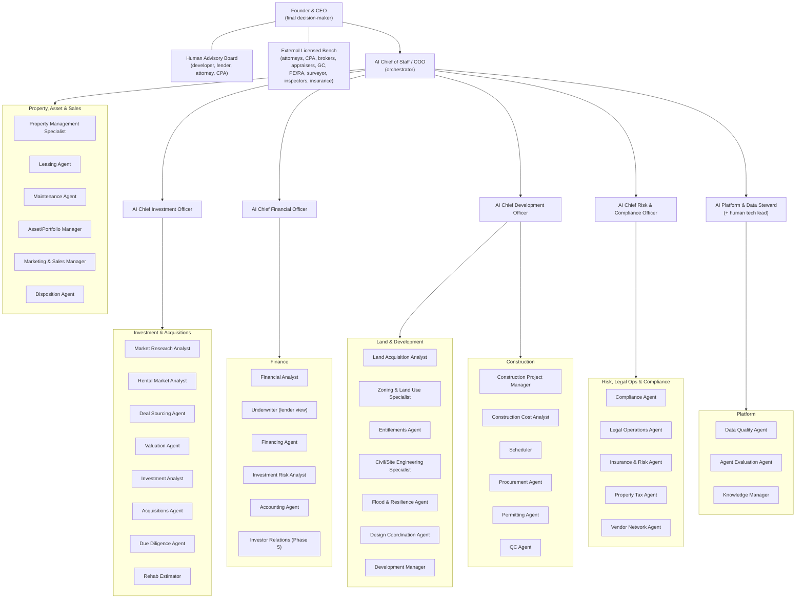

# MK.Buildings — Expert Roles, AI Workforce & Platform Knowledge Map

**Professional expertise required to operate MK.Buildings and to build its AI-powered operating system**

| Item | Detail |
|---|---|
| Document | `docs/MK_BUILDINGS_EXPERT_ROLES.md` |
| Companion document | `docs/MK_BUILDINGS_RESEARCH.md` (market, regulation, costs, strategy) |
| Research date | November 24, 2026 |
| Status | Pre-launch research (v1.0) — no application code yet |
| Founder & CEO | Final decision-maker; background in Civil Engineering; pursuing an M.S. in Business Analytics |
| Geography | South Florida (Miami-Dade, Broward, Palm Beach), Florida law |

> **Disclaimer.** This is planning research, not legal, tax, licensing, or investment advice. Licensing rules summarized here come from the Florida Statutes as published by the Florida Legislature; statutes change every session. Confirm every licensing conclusion with a Florida-licensed attorney before structuring operations.

---

## Evidence labels

| Label | Meaning |
|---|---|
| **[F]** | **Verified fact** from a primary source (statute, government agency, official standard-setting body). Source cited. |
| **[E]** | **Estimate / industry practice** — from credible secondary sources or widely used professional practice; not a legal requirement. |
| **[R]** | **Recommendation** — MK.Buildings design choice proposed by this research. |
| **[A]** | **Assumption** — planning assumption to be validated. |
| **[TBV]** | **To be verified** — could not be confirmed from a primary source during this research. |

Source tags like **[L1]** refer to the Bibliography (Section 12).

---

## Table of contents

1. [Executive summary](#1-executive-summary)
2. [Florida licensing boundaries — what AI may and may not do](#2-florida-licensing-boundaries--what-ai-may-and-may-not-do)
3. [Business domain experts — complete role catalog](#3-business-domain-experts--complete-role-catalog)
4. [Technology experts needed to build the platform](#4-technology-experts-needed-to-build-the-platform)
5. [Synthetic employee organizational structure](#5-synthetic-employee-organizational-structure)
6. [AI employee collaboration workflows](#6-ai-employee-collaboration-workflows)
7. [Knowledge and data sources](#7-knowledge-and-data-sources)
8. [Application modules and expert mapping](#8-application-modules-and-expert-mapping)
9. [Prioritized workforce and development roadmap](#9-prioritized-workforce-and-development-roadmap)
10. [Responsibility matrix: AI vs. founder vs. licensed professionals](#10-responsibility-matrix-ai-vs-founder-vs-licensed-professionals)
11. [Open questions](#11-open-questions)
12. [Bibliography](#12-bibliography)

---

## 1. Executive summary

**What this research concludes**

1. **A real estate investment + development company draws on roughly 120 distinct professional roles** across ten domains (leadership, acquisitions, finance, land & entitlement, design & engineering, construction, legal, insurance & risk, property/asset management, sales & marketing) plus about 20 technology disciplines to build the platform (Sections 3–4) **[R]**.
2. **Most analytical work can be performed by AI employees; most *signing, sealing, certifying, representing, and licensed-practice* work cannot.** Florida reserves specific acts to licensed persons: appraisal reports for compensation **[F]** [L4], contracting **[F]** [L6], architecture for most non-residential buildings **[F]** [L7], engineering, surveying, legal practice, brokerage for others **[F]** [L2], plan review/inspection by private providers **[F]** [L9], and others (Section 2).
3. **Three Florida rules shape MK.Buildings' structure directly:**
   - An entity that **sells or leases its own property** is exempt from real-estate licensing, unless it pays transaction-based commissions to staff **[F]** [L2] → MK.Buildings can manage and lease its *own* portfolio without a brokerage license, but managing others' property or paying per-deal commissions requires licensed brokerage.
   - The **owner-builder exemption cannot be used for homes built for sale or lease**; a sale or lease within 1 year of completion creates a presumption of violation **[F]** [L5] → every flip with permitted work and every spec/rental build needs a **licensed contractor**.
   - A developer selling **completed residences on its own land** is not "contracting" **if a licensed contractor is retained** to build them **[F]** [L6] → MK.Buildings can be the developer/seller without holding a contractor license itself, but must hire one.
4. **Your background is a strategic asset.** Civil engineering lets you critically review site, drainage, structural and construction information produced by AI and consultants; business analytics lets you own model governance, data quality, and KPI design. Unless you hold a Florida PE license, you still cannot seal engineering documents **[F]** [L8].
5. **Recommended operating model [R]:** a *founder + AI workforce + external licensed bench* company. The AI workforce does research, analysis, drafting, monitoring, and coordination; licensed humans perform regulated acts; the founder approves every capital commitment, contract, and public statement.
6. **Build in five phases** (Section 9): (1) data foundation + market/deal analysis agents; (2) acquisition & underwriting; (3) land & development feasibility; (4) construction & project control; (5) portfolio management & company-wide automation.

---

## 2. Florida licensing boundaries — what AI may and may not do

This section is the most important constraint on the AI workforce design. Each row states the regulated act, the source, and the consequence for MK.Buildings.

| Domain | What Florida law says (summary) | Source | Consequence for MK.Buildings |
|---|---|---|---|
| Real estate brokerage | Ch. 475 Part I regulates brokers and sales associates. Exemption: an entity that "sells, exchanges, or leases its own real property," **unless** it employs agents paid "strictly on a transactional basis" to sell/lease to the public. | **[F]** s. 475.011(2) [L2] | MK.Buildings may buy, sell and lease its own properties without a broker license. Commission-based in-house sales/leasing staff, or services for third parties, require licensed brokerage. Use licensed listing brokers for MLS exposure **[R]**. |
| Apartment leasing staff | Salaried onsite leasing employees of an apartment community owner are exempt. | **[F]** s. 475.011(4) [L2] | Relevant only for future multifamily. |
| Appraisal | "Only a certified or licensed appraiser may issue an appraisal report and receive direct compensation for providing valuation services for the appraisal report." | **[F]** s. 475.612 [L4] | AI may produce **internal valuation estimates** for MK.Buildings' own decisions; it must never be labeled or sold as an "appraisal." Lenders will order their own appraisals. |
| Contracting | A "contractor" constructs, repairs, alters, remodels, adds to, demolishes or improves buildings "for others or for resale to others." General, building, and residential contractor classes have defined scopes (e.g., residential contractor: 1–3 family, ≤ 2 habitable stories). | **[F]** s. 489.105(3) [L6] | Renovating homes for resale and building spec homes is contracting → a licensed contractor (in-house qualifier or hired GC) is required. |
| Developer exemption | "Contracting" does not extend to an entity that sells completed residences on property in which it has a legal or equitable interest, **if a qualified licensed contractor has been or will be retained** to construct them. | **[F]** s. 489.105(6) [L6] | MK.Buildings can act as developer/seller while a licensed GC builds. |
| Owner-builder | Owner-builder exemption requires the structure be for the owner's own use; sale/lease within 1 year after completion creates a presumption that it was built for sale or lease (a violation). | **[F]** s. 489.103 [L5] | Not usable for flips, spec homes, or build-to-rent. |
| Architecture | No architect required to make plans for any one-family or two-family residence, townhouse, or domestic outbuilding, regardless of cost; most other buildings over $25,000 require one. | **[F]** s. 481.229(1) [L7] | Single-family/duplex/townhouse design can be done by a non-architect designer; multifamily (3+ units) and mixed-use generally require a licensed architect **[TBV per project]**. Structural/wind design still usually requires a Florida PE seal under the Florida Building Code and local practice **[TBV per jurisdiction]**. |
| Engineering | Ch. 471 regulates engineering practice; engineering documents are signed and sealed by Florida-licensed PEs. | **[F]** ch. 471 [L8] | AI can pre-analyze (drainage, loads, site capacity) but cannot produce sealed construction documents. |
| Surveying & mapping | Ch. 472 regulates surveyors and mappers. | **[F]** ch. 472 [L8b] | Boundary, topographic, and elevation certificates come from a licensed PSM. |
| Private provider plan review & inspections | Fee owner may hire a "private provider" (licensed building code administrator, engineer, or architect) for plan review and inspections; local government must meet deadlines; when a PE/RA seals the affidavit, the building official must respond within 10 business days or the permit is deemed approved. Private provider may not inspect a building it designed or built. Insurance minimums apply. | **[F]** s. 553.791 [L9] | A powerful schedule tool for MK.Buildings; the AI Permitting agent can manage the paperwork, but the provider must be licensed. |
| Permit timeframes | Local governments must act on complete residential permit applications within set business-day deadlines (e.g., 30 business days for residential < 7,500 sq ft). | **[F]** s. 553.792 [L10] | AI Permitting agent tracks statutory clocks and fee-reduction rights. |
| Legal practice | The Florida Bar regulates the practice of law; its Ethics Opinion 24-1 (Jan 19, 2024) permits lawyers to use generative AI while protecting confidentiality, ensuring competence/accuracy, and avoiding improper billing. | **[F]** [L11] | AI may draft and summarize for review; legal advice, opinions, and court filings come from Florida attorneys. |
| Fair housing & AI | HUD (May 2, 2024) issued guidance that the Fair Housing Act applies to tenant screening and housing advertising performed with AI/algorithms; housing providers remain responsible even when using third-party tools. (Page now on HUD's archive site — current status **[TBV]**; the Fair Housing Act itself still applies.) | **[F]** [L12] | Leasing and marketing agents need bias controls, explainability, and human review of adverse decisions. |
| Landlord-tenant | Regulation of residential tenancies is preempted to the state (2023). | **[F]** [L13] | Property Management agent follows ch. 83 F.S. uniformly; evictions handled by counsel. |
| Institutional investor law | Federal ROAD to Housing Act (Public Law 119-101, July 11, 2026) restricts entities controlling ≥ 350 single-family homes from buying more, with exceptions. | **[F]** [L14] | Compliance agent tracks MK.Buildings' home count if the portfolio ever scales. |

**Other licensed categories likely needed [F — chapter exists; applicability per engagement TBV]:** home inspectors (ch. 468 Part XV), building code administrators/inspectors (ch. 468 Part XII), community association managers (ch. 468 Part VIII), mortgage brokers/loan originators (ch. 494), insurance agents/adjusters and title insurance agents (ch. 626), CPAs (ch. 473), landscape architects (ch. 481 Part II), mold assessors/remediators (ch. 468 Part XVI), geologists (ch. 492) [L8].

---

## 3. Business domain experts — complete role catalog

### 3.0 How to read each role

Each role card uses the same eight fields:

- **Does** — main responsibilities
- **Knows** — specialized knowledge and qualifications (credentials marked **[F]** are regulated licenses; professional designations are voluntary and issued by the named organization)
- **Decides** — business decisions supported
- **Needs** — information and data inputs
- **Produces** — reports and deliverables
- **AI translation** — how the expertise becomes an AI employee
- **Human-only** — tasks requiring a licensed or qualified human (or the founder)
- **Model** — recommended staffing model **[R]**: `AI` (AI employee), `AI+H` (AI employee with external human professional), `H-ext` (external licensed professional), `Founder`

Domain index (≈ 120 role cards):

| # | Domain | Roles |
|---|---|---|
| 3.1 | Executive leadership & governance | 9 |
| 3.2 | Real estate investment & acquisitions | 14 |
| 3.3 | Financial & investment analysis | 14 |
| 3.4 | Land acquisition, planning & entitlements | 13 |
| 3.5 | Site engineering & environmental | 9 |
| 3.6 | Architecture & design | 6 |
| 3.7 | Construction | 14 |
| 3.8 | Legal & regulatory | 11 |
| 3.9 | Insurance, risk & resilience | 6 |
| 3.10 | Property & asset management | 11 |
| 3.11 | Sales, marketing & disposition | 9 |
| 3.12 | Corporate operations | 6 |

---

### 3.1 Executive leadership & governance

#### 3.1.1 Founder & CEO (you)
- **Does:** Sets strategy, risk appetite and investment criteria; approves every acquisition, financing, budget, contract, hire and public statement; owns relationships with lenders, partners, and licensed advisors.
- **Knows:** Civil engineering (site, structures, construction) and business analytics (data, models, KPIs) — an unusually strong base for a data-driven developer.
- **Decides:** Go/no-go on every capital commitment; product strategy; which AI recommendations to accept.
- **Needs:** Consolidated investment memos, risk summaries, dashboards, exception alerts.
- **Produces:** Decisions with written rationale (logged), investment policy, delegation-of-authority matrix.
- **AI translation:** Not replaced. Supported by an AI Chief of Staff and an AI Executive Decision Support layer.
- **Human-only:** All final decisions; signatures; fiduciary duties to any investors.
- **Model:** `Founder`

#### 3.1.2 Chief Investment Officer (CIO)
- **Does:** Translates strategy into an investment thesis per submarket and strategy (flip, hold, develop); runs the investment committee; allocates capital across deals.
- **Knows:** Real estate finance, valuation, risk-adjusted returns, market cycles.
- **Decides:** Which deals reach the founder; target returns; portfolio allocation.
- **Needs:** Underwriting packages, market research, pipeline status, portfolio exposure.
- **Produces:** Investment committee memos; quarterly allocation plans; post-mortems.
- **AI translation:** **AI CIO** agent orchestrating acquisitions, underwriting and research agents; applies the founder's investment policy as hard rules.
- **Human-only:** None legally; final approval stays with founder.
- **Model:** `AI`

#### 3.1.3 Chief Financial Officer (CFO)
- **Does:** Capital structure, financing strategy, cash management, budgeting, financial reporting, lender and investor reporting, tax planning coordination.
- **Knows:** Corporate and project finance, GAAP, debt markets, entity structuring.
- **Decides:** Leverage limits; lender selection; reserve policy; distribution policy.
- **Needs:** Project budgets, actuals, debt terms, bank balances, forecasts.
- **Produces:** Cash-flow forecasts, monthly financial statements, covenant compliance reports, financing memos.
- **AI translation:** **AI CFO** agent (forecasting, variance analysis, loan comparison, covenant tracking) supported by accounting software integrations.
- **Human-only:** CPA-prepared tax returns and any attest work **[F]** (ch. 473) [L8]; bank signatures (founder).
- **Model:** `AI+H` (external CPA; fractional human CFO when raising outside capital **[R]**)

#### 3.1.4 Chief Operating Officer / Chief of Staff
- **Does:** Runs daily operations, task routing, deadlines, vendor coordination, standard operating procedures.
- **Knows:** Operations management, process design, project coordination.
- **Decides:** Prioritization, escalation, resourcing of AI agents.
- **Needs:** All agent task queues, calendars, contracts, deadlines.
- **Produces:** Daily brief, weekly operating review, SOP library.
- **AI translation:** **AI Chief of Staff / Orchestrator** — the "router" agent that assigns work to other agents and escalates to the founder.
- **Human-only:** None.
- **Model:** `AI`

#### 3.1.5 Chief Development Officer
- **Does:** Leads land acquisition and development: site strategy, product selection, entitlements, design, permitting, and construction oversight.
- **Knows:** Development process, feasibility analysis, entitlements, construction delivery.
- **Decides:** Product type per site; consultant team; development schedule and budget.
- **Needs:** Land intelligence, zoning, engineering, cost, market absorption data.
- **Produces:** Development recommendations, project charters, stage-gate reports.
- **AI translation:** **AI Development Director** orchestrating land, zoning, engineering, cost, and construction agents.
- **Human-only:** Representations to government bodies at hearings (attorney/planner); sealed documents (licensed design professionals).
- **Model:** `AI+H`

#### 3.1.6 Chief Risk & Compliance Officer
- **Does:** Maintains risk register, compliance calendar, policy controls (fair housing, licensing, data privacy, AI governance, institutional-investor thresholds).
- **Knows:** Regulatory compliance, enterprise risk, insurance, controls.
- **Decides:** Whether a deal or action passes compliance gates.
- **Needs:** Licenses, insurance policies, contracts, regulations, incident logs.
- **Produces:** Compliance checklists per deal, risk heat map, audit logs.
- **AI translation:** **AI Risk & Compliance Officer** agent that blocks workflows missing required approvals/documents.
- **Human-only:** Legal interpretation (attorney).
- **Model:** `AI+H`

#### 3.1.7 Chief Technology & AI Officer
- **Does:** Owns the platform roadmap, data architecture, AI model selection, security, and agent governance.
- **Knows:** Software architecture, data engineering, ML/LLM systems, security.
- **Decides:** Build vs. buy; data vendors; model and agent permissions.
- **Needs:** System metrics, costs, agent evaluation results.
- **Produces:** Architecture decisions, evaluation reports, security posture.
- **AI translation:** Partly an AI agent (monitoring, evaluation), but the platform requires human technical leadership in early phases (Section 4).
- **Human-only:** Accountability for security and data protection.
- **Model:** `AI+H` (founder + contracted senior engineer/architect)

#### 3.1.8 Investment Committee (function)
- **Does:** Structured review of each deal before founder approval: thesis, risks, mitigants, alternatives.
- **AI translation:** A multi-agent "red team" review: one agent argues for, one against, one checks data quality **[R]**.
- **Human-only:** Founder decision; optional external advisor review for large deals.
- **Model:** `AI` + `Founder`

#### 3.1.9 Board of Advisors (human)
- **Does:** Experienced South Florida developer, lender, real estate attorney, and CPA who review strategy quarterly and large deals.
- **Model:** `H-ext` **[R]**

---

### 3.2 Real estate investment & acquisitions

#### 3.2.1 Real Estate Investment Analyst
- **Does:** Screens properties; pulls comps; estimates ARV, rents, renovation, expenses; computes cash flow, cap rate, cash-on-cash, IRR, equity multiple; runs sensitivities.
- **Knows:** Valuation approaches, pro formas, Florida ownership costs (taxes, insurance, HOA), financing math.
- **Decides:** Whether a property passes initial screening; maximum allowable offer.
- **Needs:** Parcel/tax data, MLS comps and rents, rehab estimates, insurance quotes, loan terms.
- **Produces:** Deal screen (1 page), full underwriting model, sensitivity tables.
- **AI translation:** **Investment Analyst agent** — highest-value agent; deterministic financial calculations in code, LLM for narrative and data gathering **[R]**.
- **Human-only:** None legally; founder approves.
- **Model:** `AI`

#### 3.2.2 Acquisitions Manager
- **Does:** Builds and works the deal pipeline; contacts sellers/brokers; negotiates; manages LOIs, contracts, due diligence, and closing timelines.
- **Knows:** Negotiation, Florida purchase contracts (e.g., Florida Realtors/Florida Bar forms), due-diligence periods, title and closing process.
- **Decides:** Offer strategy, contingency structure, renegotiation after inspections.
- **Needs:** Pipeline CRM, underwriting, inspection results, title commitments.
- **Produces:** Offers/LOIs (drafts), contract summaries, critical-date calendars, closing checklists.
- **AI translation:** **Acquisitions agent** — drafts offers and emails, tracks deadlines, prepares negotiation briefs.
- **Human-only:** Executing contracts (founder); legal review of non-standard terms (attorney). Live negotiation can be founder-led or delegated to a licensed buyer's agent **[R]**.
- **Model:** `AI` + `Founder`

#### 3.2.3 Real Estate Investment Strategist
- **Does:** Chooses which strategies (flip, BRRRR, buy-and-hold, build-to-rent, infill spec) fit current market and capital; defines buy-box criteria.
- **Knows:** Market cycles, capital markets, comparative strategy economics.
- **Decides:** Strategy mix and target submarkets.
- **Needs:** Market research, interest rates, portfolio results.
- **Produces:** Annual/quarterly strategy, buy-box definitions.
- **AI translation:** Part of **AI CIO** responsibilities.
- **Model:** `AI` + `Founder`

#### 3.2.4 Deal Sourcing / Off-Market Lead Specialist
- **Does:** Finds properties before they hit the MLS: probate, tax-delinquent, code violations, long-term absentee owners, expired listings, pre-foreclosure, tired landlords.
- **Knows:** Public records signals, outreach compliance (telemarketing/texting rules **[TBV]**), CRM.
- **Decides:** Which leads to pursue.
- **Needs:** Property appraiser and clerk records, code enforcement, foreclosure/tax-deed calendars.
- **Produces:** Scored lead lists, outreach sequences.
- **AI translation:** **Sourcing agent** with daily scans and lead scoring.
- **Human-only:** Compliance sign-off on outreach programs (attorney).
- **Model:** `AI`

#### 3.2.5 Property Valuation Specialist (internal)
- **Does:** Selects and adjusts comparable sales; reconciles as-is and after-repair values; maintains valuation models.
- **Knows:** Sales comparison, cost and income approaches; local micro-markets.
- **Decides:** Internal value conclusions used for offers and exits.
- **Needs:** MLS closed sales, property characteristics, condition data, photos.
- **Produces:** Internal valuation reports with comp grids and confidence ranges.
- **AI translation:** **Valuation agent** (statistical AVM + comp-adjustment logic + explanation).
- **Human-only:** Must not be represented as an "appraisal" **[F]** [L4].
- **Model:** `AI`

#### 3.2.6 Certified/Licensed Real Estate Appraiser
- **Does:** Independent, USPAP-compliant appraisal reports.
- **Knows:** Florida license/certification under ch. 475 Part II **[F]**; USPAP (Appraisal Foundation) **[F]**.
- **Decides:** Supports lenders' credit decisions and disputes.
- **Produces:** Appraisal reports.
- **AI translation:** None; AI can prepare a data package for the appraiser.
- **Human-only:** Entire role **[F]** [L4].
- **Model:** `H-ext` (usually ordered by the lender)

#### 3.2.7 Real Estate Broker / Sales Associate (buyer's and listing agent)
- **Does:** MLS access, representation in purchase/sale, listing marketing, showings, negotiation.
- **Knows:** Florida license **[F]** (ch. 475), brokerage relationship disclosures, contracts.
- **Decides:** Pricing and marketing recommendations; negotiation tactics.
- **Needs:** MLS, market data.
- **Produces:** CMAs, listing agreements, offers.
- **AI translation:** AI supports (CMA drafts, listing copy) but does not act as broker.
- **Human-only:** Brokerage services for compensation for others **[F]** [L2]; MLS membership typically requires a licensee **[E]** [L20].
- **Model:** `H-ext` (one or two trusted brokers; consider the founder or an employee obtaining a license later **[R]**)

#### 3.2.8 Market Research Analyst
- **Does:** Tracks prices, inventory, absorption, migration, employment, permits, rents, competitors by submarket.
- **Knows:** Housing economics, statistics, GIS.
- **Decides:** Target submarkets; product and price positioning.
- **Needs:** MLS/association stats, Census, BLS, FRED, permits, HUD, property appraiser data.
- **Produces:** Monthly market reports, submarket scorecards, alerts.
- **AI translation:** **Market Research agent** with scheduled data refreshes.
- **Model:** `AI`

#### 3.2.9 Rental Market Analyst
- **Does:** Estimates achievable rents by unit type and condition; vacancy, concessions, seasonality; voucher (HCV) rent standards.
- **Needs:** MLS rentals, HUD FMR/SAFMR, rental listing data, multifamily reports.
- **Produces:** Rent comps, rent forecasts, lease-up assumptions.
- **AI translation:** **Rental Market agent** (part of Market Research department).
- **Model:** `AI`

#### 3.2.10 Due Diligence Coordinator
- **Does:** Runs the diligence checklist: inspections, permits history (open/expired permits), code liens, HOA estoppel, title, survey, flood, insurance quotes, leases (if occupied).
- **Needs:** Clerk records, permit portals, HOA documents, inspection reports.
- **Produces:** Diligence tracker, red-flag report.
- **AI translation:** **Due Diligence agent** — reads documents, extracts issues, chases missing items.
- **Human-only:** Physical inspections (licensed inspector), title examination (title agent/attorney).
- **Model:** `AI`

#### 3.2.11 Home Inspector
- **Does:** Visual inspection of systems and components; Florida 4-point and wind-mitigation reports are commonly required by insurers **[E]**.
- **Knows:** Florida home inspector license (ch. 468 Part XV) **[F]**; wind-mitigation forms are completed by qualified inspectors per OIR form rules **[TBV — confirm eligible professions]**.
- **Produces:** Inspection report, 4-point, wind mitigation (OIR-B1-1802 **[TBV]**).
- **AI translation:** AI extracts findings into repair scope and cost; vision models can flag items in photos **[E]**.
- **Human-only:** The inspection itself.
- **Model:** `H-ext`

#### 3.2.12 Renovation Scope & Rehab Estimator
- **Does:** Converts inspection findings and value-add plan into a scope of work and budget; decides what improvements maximize ARV/rent.
- **Knows:** Construction methods, Florida code triggers (e.g., permits for windows/roof/electrical), costs, HVHZ product approvals.
- **Decides:** Renovation level; scope priorities.
- **Needs:** Inspection reports, photos, comps of renovated homes, cost database, contractor bids.
- **Produces:** Line-item scope, budget, schedule, materials list.
- **AI translation:** **Rehab Estimator agent** (photo + report → scope → priced budget) validated against bids.
- **Human-only:** Contractor bids and execution.
- **Model:** `AI+H`

#### 3.2.13 Portfolio Manager
- **Does:** Monitors performance of all held properties; hold/sell/refinance decisions; diversification; capital improvements.
- **Needs:** Rent roll, expenses, valuations, debt terms, market data.
- **Produces:** Portfolio dashboard, hold/sell analyses, refinance recommendations.
- **AI translation:** **Portfolio Manager agent** (Phase 5).
- **Model:** `AI`

#### 3.2.14 Distressed Asset & Auction Specialist
- **Does:** Evaluates foreclosure auctions, tax-deed sales, REO, short sales; title and lien risk unique to these sales.
- **Knows:** Florida foreclosure and tax-deed processes; lien survival rules **[TBV — attorney]**.
- **Needs:** Clerk auction calendars, lien searches.
- **Produces:** Auction bid sheets and maximum bids.
- **AI translation:** Sub-skill of Sourcing + Due Diligence agents.
- **Human-only:** Title/legal opinion on lien survival.
- **Model:** `AI+H`

---

### 3.3 Financial & investment analysis

#### 3.3.1 Real Estate Financial Analyst
- **Does:** Builds project and portfolio cash flows; tracks actual vs. budget; prepares lender reports.
- **Produces:** Monthly project financials, variance analyses.
- **AI translation:** **Financial Analyst agent** under the AI CFO.
- **Model:** `AI`

#### 3.3.2 Real Estate Underwriter
- **Does:** Independently stress-tests deals the way a lender would: DSCR, LTV/LTC, debt yield, sponsor liquidity, exit risk.
- **Knows:** Lender underwriting standards (agency, DSCR, RTL/bridge, construction).
- **Decides:** Whether a deal is financeable and at what leverage.
- **Produces:** Underwriting checklist, lender-ready package.
- **AI translation:** **Underwriting agent** acting as internal "lender's view" check, independent of the Investment Analyst **[R]**.
- **Model:** `AI`

#### 3.3.3 Financial Modeling Specialist
- **Does:** Designs and maintains standardized models (flip, rental, development, portfolio); version control; audit of formulas.
- **Knows:** DCF, waterfalls, IRR/XIRR, development draw schedules, sensitivity/Monte Carlo.
- **Produces:** Model library with tests.
- **AI translation:** Implemented as **tested code modules** (not free-form LLM math) **[R]**; the founder's analytics background is directly relevant here.
- **Model:** `AI` (built by human engineer + founder review)

#### 3.3.4 Tax Accountant / CPA
- **Does:** Entity tax structure, depreciation and cost segregation strategy, dealer vs. investor treatment of flips, 1031 exchanges, Florida documentary stamp and other taxes, tax returns.
- **Knows:** CPA license **[F]** (ch. 473).
- **Decides:** Tax structuring; holding period strategies.
- **Produces:** Tax returns, structuring memos.
- **AI translation:** AI organizes books and flags tax questions; prepares workpapers.
- **Human-only:** Tax advice and filings **[R]**; attest services **[F]**.
- **Model:** `H-ext`

#### 3.3.5 Bookkeeper / Controller
- **Does:** Transaction coding, reconciliations, AP/AR, job costing by project, closing the books monthly.
- **AI translation:** **Accounting agent** integrated with accounting software and bank feeds.
- **Human-only:** Periodic CPA review **[R]**.
- **Model:** `AI+H`

#### 3.3.6 Real Estate Investment Advisor
- **Does:** Advises on portfolio strategy for clients.
- **Note:** Providing investment advice to others for compensation can trigger investment-adviser regulation **[TBV — securities counsel]**. For MK.Buildings' own account, this function is internal.
- **Model:** `AI` (internal only)

#### 3.3.7 Mortgage & Construction Financing Specialist
- **Does:** Sources and compares debt (DSCR, hard money/RTL, construction, bank portfolio, lines of credit); manages applications, draws, extensions, refinancing.
- **Knows:** Loan products; Florida mortgage broker/loan originator licensing (ch. 494) applies to those brokering loans for others **[F]**.
- **Decides:** Lender selection and loan structure.
- **Produces:** Loan comparison matrix, application packages, draw requests.
- **AI translation:** **Financing agent** (term-sheet comparison, document packaging, draw tracking).
- **Human-only:** Loan brokerage by licensed mortgage brokers (if used); founder signs loan documents and guarantees.
- **Model:** `AI+H`

#### 3.3.8 Investment Risk Analyst
- **Does:** Quantifies downside: rate shocks, price declines, cost overruns, delays, insurance shocks, hurricane/flood exposure, concentration risk.
- **Produces:** Stress tests, scenario analysis, risk scores per deal.
- **AI translation:** **Risk Analyst agent** (scenario engine + climate risk layers).
- **Model:** `AI`

#### 3.3.9 Capital Markets & Investor Relations Manager
- **Does:** Raises equity (friends & family, JV partners, syndications, funds); prepares investor materials and reporting.
- **Knows:** Securities law constraints (federal and Florida) — offerings must be registered or exempt **[F — general principle; specifics TBV with securities counsel]**.
- **Produces:** Investor decks, quarterly investor reports, capital account statements.
- **AI translation:** **Investor Relations agent** drafts reports; nothing is sent to investors without attorney-approved templates and founder approval.
- **Human-only:** Securities counsel; any broker-dealer activities.
- **Model:** `AI+H` (Phase 5)

#### 3.3.10 Treasury & Cash Management
- **Does:** Liquidity forecasting, reserves, escrow tracking, interest-rate risk on floating debt.
- **AI translation:** Part of AI CFO.
- **Model:** `AI`

#### 3.3.11 Cost Segregation Specialist
- **Does:** Engineering-based study allocating building costs to shorter depreciation lives.
- **Model:** `H-ext` (with CPA) — only for held rentals/new construction.

#### 3.3.12 1031 Qualified Intermediary
- **Does:** Holds exchange proceeds in like-kind exchanges.
- **Model:** `H-ext` (only if pursuing 1031 exchanges).

#### 3.3.13 Insurance Cost Analyst
- **Does:** Models premiums (HO-3, DP-3, flood, builder's risk, GL) and mitigation credits for each deal.
- **AI translation:** Sub-agent of Risk/Insurance department.
- **Model:** `AI`

#### 3.3.14 Business / Data Analyst (KPI owner)
- **Does:** Company KPIs, model accuracy tracking (forecast vs. actual), data quality metrics.
- **AI translation:** **Analytics agent**; founder oversees (matches your M.S. in Business Analytics).
- **Model:** `AI` + `Founder`

---

### 3.4 Land acquisition, planning & entitlements

#### 3.4.1 Land Acquisition Specialist
- **Does:** Finds vacant/teardown/infill land; contacts owners; negotiates land contracts with feasibility periods and entitlement contingencies.
- **Knows:** Land valuation (residual method), zoning basics, platting, utilities.
- **Decides:** Which sites to pursue and at what price/terms.
- **Needs:** Parcel data (land use codes for vacant land), zoning, FLU maps, flood maps, utilities, land sales.
- **Produces:** Site screening memos, land LOIs (drafts), land comps.
- **AI translation:** **Land Acquisition Analyst agent** (scans every vacant/underused parcel; scores sites).
- **Model:** `AI` + `Founder`

#### 3.4.2 Land Development Manager
- **Does:** Manages pre-development: consultants, surveys, studies, site plans, platting, utility agreements, permits for site work.
- **Produces:** Pre-development schedule and budget; consultant scopes.
- **AI translation:** **Development Manager agent**.
- **Model:** `AI+H`

#### 3.4.3 Real Estate Development Director
- See 3.1.5 (Chief Development Officer). In a larger firm this is a separate senior role leading multiple projects.
- **Model:** `AI`

#### 3.4.4 Land Use Planner
- **Does:** Interprets comprehensive plans (e.g., Miami-Dade CDMP), future land use, density, compatibility; prepares planning justification.
- **Knows:** Florida growth management (ch. 163 F.S.); AICP certification (American Planning Association) is a voluntary designation **[F — exists]**.
- **Decides:** Achievable density/use; rezoning strategy.
- **Produces:** Planning analysis, entitlement strategy.
- **AI translation:** **Land Use & Zoning agent** (reads codes, maps, CDMP policies).
- **Human-only:** Expert testimony and representation at hearings (planner/attorney).
- **Model:** `AI+H`

#### 3.4.5 Zoning Specialist
- **Does:** Determines permitted uses, setbacks, height, lot coverage, FAR, parking, minimum lot size, ADU rules, overlays for a specific parcel; zoning verification letters.
- **Needs:** Municipal zoning codes and maps (each of the ~90+ municipalities plus unincorporated areas in the three counties **[E]**), Live Local Act rules.
- **Produces:** Zoning analysis memo; buildable envelope; yield study (number of units).
- **AI translation:** **Zoning agent** — retrieval over codes + structured rule extraction + GIS envelope calculation.
- **Human-only:** Official zoning determinations come from the jurisdiction; legal interpretation in disputes from land use counsel.
- **Model:** `AI+H`

#### 3.4.6 Entitlements Specialist
- **Does:** Manages rezoning, variances, site plan approvals, plats, special exceptions, Live Local administrative approvals; community outreach.
- **Produces:** Applications, hearing schedules, conditions-of-approval tracker.
- **AI translation:** **Entitlements agent** (application assembly, deadline tracking, condition tracking).
- **Human-only:** Hearing representation (attorney/planner).
- **Model:** `AI+H`

#### 3.4.7 Land Use & Zoning Attorney
- See 3.8.3.

#### 3.4.8 Impact Fee & Concurrency Specialist
- **Does:** Calculates impact fees (roads, schools, parks, fire, police), utility connection fees, concurrency/mobility fees.
- **Needs:** County and municipal fee schedules **[TBV per jurisdiction]**.
- **AI translation:** Sub-skill of Development Cost agent.
- **Model:** `AI`

#### 3.4.9 Affordable / Workforce Housing Specialist (Live Local)
- **Does:** Structures Live Local Act projects (≥ 40% affordable for 30 years), income/rent limits, compliance, incentives.
- **Needs:** Florida Housing rent/income limits, local Live Local procedures.
- **AI translation:** **Live Local agent** (Phase 3+).
- **Human-only:** Land use counsel; compliance monitoring partner.
- **Model:** `AI+H`

#### 3.4.10 Subdivision / Platting Specialist
- **Does:** Lot splits, replats, tentative/final plats, easements and dedications.
- **Human-only:** Surveyor (plat preparation), engineer, county approval.
- **Model:** `AI+H`

#### 3.4.11 Utility Coordinator
- **Does:** Confirms water/sewer availability and capacity (e.g., county water & sewer departments, city utilities), septic vs. sewer, FPL electrical service, connection fees.
- **AI translation:** Sub-agent of Civil/Site agent.
- **Model:** `AI+H`

#### 3.4.12 Economic Development & Incentives Specialist
- **Does:** Identifies grants, tax incentives, opportunity zones, affordable housing finance programs.
- **Model:** `AI` (Phase 5)

#### 3.4.13 Community Relations / Neighborhood Outreach
- **Does:** Prepares neighbors and stakeholders for development; manages objections.
- **Human-only:** In-person meetings (founder/planner).
- **Model:** `AI+H`

---

### 3.5 Site engineering & environmental

#### 3.5.1 Civil Engineer (site/land development)
- **Does:** Site layout, grading, drainage and stormwater, utilities, paving, erosion control, permitting with water management district and county.
- **Knows:** Florida PE license **[F]** (ch. 471); SFWMD Environmental Resource Permitting **[E]**.
- **Decides:** Site feasibility, cost drivers (fill, drainage), lot yield.
- **Needs:** Survey, geotech, flood data, utility maps, codes.
- **Produces:** Sealed civil plans, drainage calculations, permit applications.
- **AI translation:** **Civil Engineering Specialist agent** — preliminary site capacity, fill estimates, drainage red flags, flood elevation implications.
- **Human-only:** Sealed engineering documents **[F]**. You can review technically; sealing requires a Florida PE.
- **Model:** `AI+H`

#### 3.5.2 Professional Surveyor & Mapper
- **Does:** Boundary, topographic, ALTA/NSPS surveys, elevation certificates, plats.
- **Knows:** Florida PSM license **[F]** (ch. 472).
- **Produces:** Surveys, elevation certificates.
- **AI translation:** AI reads surveys and extracts easements/encroachments.
- **Human-only:** Entire field and certification work.
- **Model:** `H-ext`

#### 3.5.3 Geotechnical Engineer
- **Does:** Soil borings, foundation recommendations, limestone/muck issues, groundwater, compaction testing.
- **Human-only:** Licensed PE; testing lab.
- **Model:** `H-ext`

#### 3.5.4 Environmental Consultant
- **Does:** Phase I Environmental Site Assessment (commonly to ASTM E1527-21 for "all appropriate inquiries" under federal CERCLA rules 40 CFR Part 312) **[F — standard exists]**; Phase II sampling; contamination databases; county environmental permits (e.g., Miami-Dade DERM **[TBV]**).
- **Produces:** Phase I/II reports.
- **AI translation:** AI pre-screens government environmental databases for nearby contamination and flags need for Phase I.
- **Human-only:** Environmental professional's report.
- **Model:** `AI+H`

#### 3.5.5 Wetlands / Ecological Consultant
- **Does:** Wetland delineation, protected species (e.g., FWC/USFWS), mitigation.
- **Model:** `H-ext`

#### 3.5.6 Floodplain & Stormwater Specialist
- **Does:** FEMA flood zone/BFE analysis, local freeboard, elevation strategy, flood insurance implications, sea-level-rise planning; Certified Floodplain Manager (CFM) designation is offered by ASFPM **[F — exists]**.
- **AI translation:** **Flood & Resilience agent** (NFHL, elevation certificates, SLR layers).
- **Model:** `AI+H`

#### 3.5.7 Traffic Engineer
- **Does:** Traffic statements/studies, driveway permits, access management.
- **Model:** `H-ext` (multifamily/subdivisions only)

#### 3.5.8 Landscape Architect
- **Does:** Landscape and tree-mitigation plans; license under ch. 481 Part II **[F]** where required.
- **Model:** `H-ext`

#### 3.5.9 Arborist / Tree Permit Specialist
- **Does:** Tree surveys and removal/mitigation permits (local tree ordinances) **[TBV per jurisdiction]**.
- **Model:** `H-ext`

---

### 3.6 Architecture & design

#### 3.6.1 Architect
- **Does:** Design, construction documents, code compliance, construction administration.
- **Knows:** Florida license **[F]** (ch. 481); not legally required for 1–2 family homes and townhouses **[F]** [L7].
- **Decides:** Design solutions within budget and code.
- **Produces:** Schematic → design development → construction documents.
- **AI translation:** **Design Coordination agent** — program definition, plan library management, code checklists, generative massing options for feasibility.
- **Human-only:** Sealed architectural documents where required.
- **Model:** `H-ext` (multifamily/mixed-use) or residential designer (1–2 family) **[R]**

#### 3.6.2 Residential Designer / Plan Library Manager
- **Does:** Develops a repeatable library of home plans optimized for South Florida lots, codes, and buyer preferences.
- **AI translation:** **Product Design agent** tracks which plans perform best (cost/sq ft, sale price/sq ft, days on market).
- **Model:** `AI+H`

#### 3.6.3 Structural Engineer
- **Does:** Structural design for wind loads (HVHZ in Miami-Dade/Broward **[F]**), foundations, CMU/concrete, trusses; sealed drawings.
- **Human-only:** Florida PE seal **[F]**.
- **Model:** `H-ext`

#### 3.6.4 MEP Engineer
- **Does:** Mechanical, electrical, plumbing design where required; energy calculations.
- **Model:** `H-ext`

#### 3.6.5 Energy Code / Green Building Consultant
- **Does:** Florida Energy Code compliance calculations; optional green certifications.
- **Model:** `H-ext` / `AI+H`

#### 3.6.6 Interior Designer / Finish Specifier
- **Does:** Finish selections for target buyer/renter; residential interior design is exempt from architect licensure **[F]** (s. 481.229(6)).
- **AI translation:** **Finish Selection agent** (standard finish packages by price tier; trend data from comps' photos).
- **Model:** `AI`

---

### 3.7 Construction

#### 3.7.1 General Contractor (licensed)
- **Does:** Pulls permits, builds or renovates, manages subcontractors, warrants work.
- **Knows:** Florida certified/registered general, building, or residential contractor license **[F]** (ch. 489) [L6].
- **Human-only:** Contracting itself **[F]**.
- **Model:** `H-ext` (initially); later option: hire an in-house licensed qualifier (ch. 489 primary qualifying agent) to form an affiliated construction company **[R]**.

#### 3.7.2 Construction Manager (owner's representative)
- **Does:** Represents MK.Buildings in front of the GC: scope, budget, schedule, quality, change orders, payment applications, lien waivers.
- **Knows:** Construction management (CMAA's CCM designation is voluntary **[F — exists]**).
- **Decides:** Approval recommendations for draws and change orders.
- **Needs:** Contracts, schedules, pay apps, photos, inspection results.
- **Produces:** Weekly reports, draw recommendations, change-order logs.
- **AI translation:** **Construction Project Manager agent** + periodic human site visits.
- **Human-only:** Physical site observation; founder approves payments.
- **Model:** `AI+H` (your civil engineering background lets you act as owner's rep on early projects **[R]**)

#### 3.7.3 Project Manager
- **Does:** Day-to-day coordination of a specific project across consultants, GC, lenders, inspectors.
- **AI translation:** One **Project agent instance** per project.
- **Model:** `AI`

#### 3.7.4 Site Superintendent
- **Does:** On-site supervision of daily work, safety, sequencing.
- **Human-only:** Physical presence (GC's employee).
- **Model:** `H-ext` (GC)

#### 3.7.5 Cost Estimator / Quantity Surveyor
- **Does:** Quantity takeoffs, unit pricing, conceptual to detailed estimates, bid leveling.
- **Knows:** Estimating methods; AACE International certifications are voluntary **[F — exists]**.
- **Needs:** Drawings, specs, cost databases (e.g., RSMeans), historical actuals, vendor quotes.
- **Produces:** Conceptual estimates (feasibility), detailed estimates, bid comparisons.
- **AI translation:** **Construction Cost Analyst agent** — parametric estimates early; plan-based takeoff tools later; learns from MK.Buildings' own actual costs.
- **Model:** `AI+H`

#### 3.7.6 Scheduler
- **Does:** CPM schedules, look-aheads, delay analysis.
- **AI translation:** **Scheduling agent** (templates per product; risk-adjusted durations including permit clocks and hurricane season).
- **Model:** `AI`

#### 3.7.7 Procurement Specialist
- **Does:** Long-lead items (impact windows/doors, roof systems, trusses, HVAC), approved-product verification (Florida Product Approval / Miami-Dade NOA) **[F]** [L21][L22], price tracking.
- **AI translation:** **Procurement agent** (product approval checks, quote comparisons, lead-time alerts).
- **Model:** `AI`

#### 3.7.8 Construction Cost Controller
- **Does:** Budget vs. committed vs. actual; contingency burn; forecast at completion.
- **AI translation:** **Cost Control agent** (part of Construction department).
- **Model:** `AI`

#### 3.7.9 Building Code Official / Private Provider / Inspector
- **Does:** Plan review and code inspections. Private providers (licensed building code administrator, PE, or RA) can be hired by the owner **[F]** [L9].
- **Human-only:** Entire role **[F]**.
- **Model:** `H-ext`

#### 3.7.10 Quality Control Specialist
- **Does:** Pre-drywall, pre-close, punch-list inspections against standards; photo documentation.
- **AI translation:** **QC agent** (checklists, photo review, defect tracking).
- **Human-only:** Physical inspection.
- **Model:** `AI+H`

#### 3.7.11 Threshold / Special Inspector
- **Does:** Required for "threshold buildings" (larger structures) under Florida law **[TBV — confirm definitions in s. 553.71/553.79]**.
- **Model:** `H-ext` (multifamily only)

#### 3.7.12 Safety Coordinator
- **Does:** OSHA compliance on site (GC's responsibility; owner monitors).
- **Model:** `H-ext` (GC)

#### 3.7.13 Warranty & Customer Care Manager
- **Does:** Post-closing warranty requests for homes sold; Florida construction defect claims process (ch. 558 F.S.) **[F — chapter exists; process details TBV]**.
- **AI translation:** **Warranty agent**.
- **Model:** `AI+H`

#### 3.7.14 Specialty Trade Contractors
- **Does:** Roofing, electrical, plumbing, HVAC, pool, etc. — separately licensed under ch. 489 **[F]** [L6] (electrical under Part II).
- **AI translation:** **Vendor Network agent** verifies licenses (DBPR) and insurance before engagement.
- **Model:** `H-ext`

---

### 3.8 Legal & regulatory

#### 3.8.1 Real Estate Attorney (general counsel)
- **Does:** Entity formation and operating agreements, purchase/sale contracts, leases, disputes.
- **Knows:** Member of The Florida Bar **[F]**; Florida Bar board certification in Real Estate law exists as a voluntary specialty **[TBV — confirm current program name]**.
- **AI translation:** **Legal Operations agent** — contract abstraction, clause comparison against approved templates, deadline tracking, issue lists for counsel.
- **Human-only:** Legal advice, drafting of binding documents, representation **[F]** [L11].
- **Model:** `H-ext`

#### 3.8.2 Real Estate Transaction Attorney / Closing Counsel
- **Does:** Reviews title commitments, surveys, closing documents; handles closings and escrow.
- **Model:** `H-ext`

#### 3.8.3 Land Use & Zoning Attorney
- **Does:** Entitlement strategy, Live Local Act applications, hearings, appeals, development agreements.
- **Model:** `H-ext` (Phase 3+)

#### 3.8.4 Construction Attorney
- **Does:** Construction contracts (AIA/ConsensusDocs or custom), lien law (Florida construction lien law, ch. 713 **[F — chapter exists]**), defect claims, payment disputes.
- **Model:** `H-ext`

#### 3.8.5 Title Agent / Closing Specialist
- **Does:** Title searches, title commitments and policies, settlement statements, recording, payoffs.
- **Knows:** Title insurance agent licensing (ch. 626) **[TBV — confirm]**.
- **AI translation:** **Closing Coordinator agent** tracks requirements and documents.
- **Human-only:** Title insurance and escrow.
- **Model:** `H-ext`

#### 3.8.6 Real Estate Tax Specialist / Property Tax Consultant
- **Does:** Property tax appeals (Value Adjustment Board), exemption strategy, Amendment 3 impact analysis, documentary stamp tax planning.
- **AI translation:** **Property Tax agent** (assessment monitoring, TRIM notice review, appeal recommendations).
- **Human-only:** Representation before VAB (rules on who may represent **[TBV]**).
- **Model:** `AI+H`

#### 3.8.7 Securities & Corporate Attorney
- **Does:** Capital raising structures, private placement documents, investor agreements.
- **Model:** `H-ext` (only when raising outside capital)

#### 3.8.8 Landlord-Tenant / Eviction Attorney
- **Does:** Lease enforcement and evictions under ch. 83 F.S.
- **Model:** `H-ext`

#### 3.8.9 Regulatory Compliance Specialist
- **Does:** Maintains compliance obligations: licenses, annual reports (Sunbiz), flood disclosures (s. 689.302 and landlord disclosure), fair housing, HOA/condo rules, ROAD Act thresholds, data privacy.
- **AI translation:** **Compliance agent** under the AI Chief Risk Officer.
- **Model:** `AI+H`

#### 3.8.10 Fair Housing Compliance Specialist
- **Does:** Audits leasing criteria, advertising, screening tools, reasonable accommodation processes.
- **AI translation:** Bias testing of leasing/marketing agents; adverse-action review queue **[R]** (per HUD AI guidance [L12]).
- **Model:** `AI+H`

#### 3.8.11 Privacy, Data & AI Governance Counsel
- **Does:** Data licensing terms (MLS, vendors), tenant data privacy, AI use policies, vendor contracts.
- **Model:** `H-ext`

---

### 3.9 Insurance, risk & resilience

#### 3.9.1 Insurance Broker / Agent
- **Does:** Places HO-3/DP-3, flood, builder's risk, general liability, umbrella, vacant property, professional/E&O, cyber.
- **Knows:** Florida insurance agent license (ch. 626) **[F — chapter exists]**.
- **Human-only:** Binding coverage.
- **Model:** `H-ext`

#### 3.9.2 Insurance & Risk Management Specialist (internal)
- **Does:** Coverage requirements per project, certificate-of-insurance tracking for vendors, claims management, renewal strategy.
- **AI translation:** **Insurance & Risk agent** (COI tracking, coverage gap analysis).
- **Model:** `AI`

#### 3.9.3 Wind Mitigation & Hurricane Preparedness Specialist
- **Does:** Hurricane hardening (roof, openings) to reduce premiums and losses; storm preparation plans for active projects and rentals.
- **AI translation:** **Resilience agent** (mitigation ROI, storm checklists triggered by NOAA/NHC alerts **[R]**).
- **Model:** `AI+H`

#### 3.9.4 Climate & Flood Risk Analyst
- **Does:** Parcel-level flood, sea-level rise, storm surge, and heat risk; long-term value impact.
- **AI translation:** Part of **Flood & Resilience agent**.
- **Model:** `AI`

#### 3.9.5 Public Adjuster / Claims Specialist
- **Does:** Represents the insured in property claims; licensed under ch. 626 **[TBV]**.
- **Model:** `H-ext` (as needed)

#### 3.9.6 Security & Asset Protection
- **Does:** Vacant-property security, theft prevention on job sites (cameras, smart locks).
- **Model:** `AI` (monitoring) + vendors

---

### 3.10 Property & asset management

#### 3.10.1 Residential Property Manager
- **Does:** Leasing, rent collection, maintenance coordination, resident relations, renewals, move-in/out, legal notices, accounting.
- **Knows:** Florida landlord-tenant law (ch. 83); for managing *others'* properties for compensation, a broker license is required; managing its **own** properties is exempt **[F]** [L2].
- **AI translation:** **Property Management Specialist agent** (resident communications, work-order triage, rent reminders, renewals).
- **Human-only:** Physical tasks; evictions (attorney); founder approval of lease exceptions.
- **Model:** `AI` + vendors; or `H-ext` third-party manager early **[R]**

#### 3.10.2 Asset Manager
- **Does:** Maximizes asset value: business plan per property, capex, rent strategy, refinance/sale timing.
- **AI translation:** **Asset Manager agent**.
- **Model:** `AI`

#### 3.10.3 Leasing Specialist
- **Does:** Listings, inquiries, showings (self-guided tours possible), applications, screening, lease execution.
- **AI translation:** **Leasing agent** with fair-housing guardrails [L12]; screening via compliant third-party providers with documented criteria **[R]**.
- **Human-only:** Adverse-action review; reasonable accommodation decisions (founder/counsel).
- **Model:** `AI+H`

#### 3.10.4 Property Maintenance Manager
- **Does:** Preventive maintenance schedules, work-order dispatch, vendor quality, turn management.
- **AI translation:** **Maintenance agent** (triage, dispatch, cost tracking).
- **Human-only:** Licensed trades for regulated work.
- **Model:** `AI` + vendors

#### 3.10.5 Property Operations Manager
- **Does:** Standardizes operations across the portfolio: SOPs, KPIs (occupancy, delinquency, turn time, cost per unit).
- **AI translation:** Part of **Operations department**.
- **Model:** `AI`

#### 3.10.6 Facilities Management Specialist
- **Does:** Building systems lifecycle (roof, HVAC, water heaters), capital planning, warranties.
- **AI translation:** **Capital Planning agent** (component age registry, replacement forecasts).
- **Model:** `AI`

#### 3.10.7 Turnover / Make-Ready Coordinator
- **Does:** Scopes and schedules unit turns between residents.
- **Model:** `AI` + vendors

#### 3.10.8 Community Association Manager (CAM)
- **Does:** Manages HOA/condo associations — relevant if MK.Buildings creates an HOA in a new community and controls it before turnover. Licensed under ch. 468 Part VIII **[F — chapter exists; thresholds TBV]**; HOA governance rules in ch. 720 (e.g., HB 1203, 2024).
- **Model:** `H-ext` (Phase 4+)

#### 3.10.9 Resident Services / Customer Experience
- **Does:** Resident satisfaction, communications, renewals.
- **Model:** `AI`

#### 3.10.10 Housing Choice Voucher (Section 8) Coordinator
- **Does:** Works with local housing authorities (inspections, payment standards, HAP contracts).
- **Model:** `AI+H` (optional strategy)

#### 3.10.11 Vendor & Contractor Network Manager
- **Does:** Recruits, vets (license, insurance, references), rates, and pays vendors.
- **AI translation:** **Vendor Network agent** (DBPR license verification, COI tracking, scorecards).
- **Model:** `AI`

---

### 3.11 Sales, marketing & disposition

#### 3.11.1 Real Estate Marketing Strategist
- **Does:** Brand, positioning, channel strategy, budgets; fair-housing-compliant advertising.
- **AI translation:** **Marketing Strategy agent**.
- **Model:** `AI` + `Founder`

#### 3.11.2 Residential Sales Specialist / Listing Broker
- **Does:** Lists and sells completed flips and new homes through the MLS; negotiates with buyers' agents.
- **Human-only:** Licensed brokerage for MLS listing and commission-based sales **[F]** [L2].
- **Model:** `H-ext`

#### 3.11.3 Disposition Manager
- **Does:** Exit planning: pricing, timing, staging, price reductions, buyer financing incentives (rate buydowns), closing coordination.
- **AI translation:** **Disposition agent** (pricing model, days-on-market monitoring, price-change recommendations).
- **Model:** `AI` + `Founder`

#### 3.11.4 Market Positioning Analyst
- **Does:** Determines target buyer/renter segment, price point, and features per product and submarket.
- **AI translation:** Part of Market Research department.
- **Model:** `AI`

#### 3.11.5 Customer & Buyer Research Specialist
- **Does:** Buyer personas, feature preferences, financing profiles (cash vs. mortgage), migration sources.
- **AI translation:** **Buyer Research agent** (listing remarks, showing feedback, surveys).
- **Model:** `AI`

#### 3.11.6 Content, Photography & Staging
- **Does:** Professional photos, video, 3D tours, virtual/physical staging, listing copy.
- **AI translation:** **Content agent** for copy and virtual staging (disclose virtual staging **[R]**).
- **Model:** `AI` + vendors

#### 3.11.7 Digital Marketing & CRM Specialist
- **Does:** Lead capture, nurture, analytics, ad platform management (with fair housing constraints on targeting [L12]).
- **Model:** `AI`

#### 3.11.8 New-Home Sales Consultant
- **Does:** For new communities: model homes, contracts, selections, construction updates to buyers.
- **Model:** `H-ext` (licensed) — Phase 4+

#### 3.11.9 Brand & Reputation Manager
- **Does:** Reviews, PR, website, social media.
- **Model:** `AI` + `Founder`

---

### 3.12 Corporate operations

#### 3.12.1 Operations Manager
- **Does:** Orchestrates processes and agents; KPI dashboard; vendor and contract database; compliance calendar.
- **AI translation:** **AI Operations Manager** (reports to AI Chief of Staff).
- **Model:** `AI`

#### 3.12.2 Executive Assistant
- **Does:** Calendar, email triage, meeting prep, travel.
- **Model:** `AI`

#### 3.12.3 Document Controller / Records Manager
- **Does:** Organizes deal rooms, versions, retention (e.g., closing files, permits, warranties, leases).
- **Model:** `AI`

#### 3.12.4 Knowledge Manager
- **Does:** Maintains the company knowledge base (SOPs, playbooks, lessons learned, code summaries) used by all agents.
- **Model:** `AI` + `Founder` review

#### 3.12.5 Human Resources (minimal)
- **Does:** Contractor agreements, payroll for any human staff, worker classification.
- **Model:** `H-ext` (PEO/payroll provider)

#### 3.12.6 Procurement & Vendor Contracts (corporate)
- **Does:** Software, data, and service contracts; renewals.
- **Model:** `AI`

---

## 4. Technology experts needed to build the platform

**Principle [R]:** AI coding tools can write a large share of the code, tests, and documentation, but a small number of experienced humans must own **architecture, data rights, security, and evaluation**, because mistakes there are expensive and hard to see.

| Role | What they contribute | What AI development tools can handle | Human necessity | Phase |
|---|---|---|---|---|
| **Product Manager / Product Owner** | Converts business workflows (Section 6) into prioritized features, acceptance criteria, and success metrics. | Drafting user stories, specs, release notes. | **Founder can own this** (with AI support). | 1 |
| **Real Estate Technology (PropTech) Specialist** | Knows industry systems: MLS/RESO standards, property management and accounting software, construction management tools, lender portals; recommends buy-vs-build. | Vendor research summaries. | Advisor (part-time). | 1–2 |
| **Software Architect** | Overall system design: services, data flows, agent orchestration, security boundaries, scalability, cost. | Diagrams, boilerplate, alternatives analysis. | **Yes — senior human** (contract). | 1 |
| **Full-Stack Developer** | Builds features end-to-end. | Much of the code (CRUD, UI, APIs, tests). | 1 human lead to review/merge. | 1–5 |
| **Backend Developer** | APIs, business logic, financial calculation engines, job schedulers. | Code generation; test generation. | Review of financial logic correctness. | 1–5 |
| **Frontend Developer** | Dashboards, maps, deal workspaces, approval screens. | Components and layouts. | Light. | 2–5 |
| **Data Engineer** | Ingestion pipelines (property appraiser bulk files, FDOR NAL/SDF, GIS layers, MLS feeds, permits), data quality checks, entity resolution (address/folio matching). | Pipeline code, parsers. | **Yes** — data quality is foundational. | 1 |
| **Database Architect** | Data model for parcels, properties, deals, projects, leases, vendors, documents; spatial indexing; audit history. | Schema drafts, migrations. | Review. | 1 |
| **GIS / Geospatial Data Specialist** | Parcel geometry, zoning/FLU/flood overlays, buildable envelope calculation, distance/adjacency analyses. | Spatial query code. | **Yes** — South Florida land analysis depends on it. | 1–3 |
| **Data Scientist** | AVMs, rent models, ARV models, lead-scoring, cost prediction, model validation and drift monitoring. | Feature engineering, model training code. | **Yes** (founder's analytics training applies). | 2 |
| **AI / Machine Learning Engineer** | Model deployment, retrieval systems (codes, ordinances, contracts), document extraction, vision (photos/plans). | Most implementation. | Review & evaluation. | 1–3 |
| **AI Agent Architect** | Designs agent roles, tools, permissions, memory, handoffs, approval gates, evaluation harnesses; prevents agents from acting beyond authority. | Prompt/tool scaffolding. | **Yes** — core of the "AI employee" concept. | 1 |
| **LLM Evaluation / QA Specialist** | Test sets for each agent (e.g., 50 known deals with correct answers), hallucination checks, citation verification, regression tests. | Test case generation. | **Yes** — trust requires measurement. | 1–5 |
| **Automation Engineer** | Workflow automation: email/calendar, document generation, e-signature routing, notifications, integrations with accounting/PM software. | Most implementation. | Light. | 2–5 |
| **Business Intelligence Developer** | KPI dashboards, portfolio reporting, model-vs-actual tracking. | Dashboard code. | Founder-led. | 2–5 |
| **UX/UI Designer** | Decision-centric design: memo views, map views, approval queues, mobile site-visit tools. | Prototypes. | Part-time. | 2 |
| **Cybersecurity Specialist** | Identity and access, secrets, encryption, tenant/investor PII protection, vendor risk, incident response, wire-fraud controls (a major real estate risk **[E]**). | Config checks, scans. | **Yes** (periodic audit). | 1, recurring |
| **API Integration Specialist** | Connects MLS (RESO Web API), data vendors, accounting, banking, e-signature, permits portals, GIS services. | Client code. | Light. | 1–5 |
| **Cloud Infrastructure / DevOps Engineer** | Environments, CI/CD, monitoring, backups, cost control. | IaC templates. | Part-time. | 1 |
| **Data Governance & Licensing Specialist** | Tracks the license terms of every dataset (what can be stored, displayed, used for AI); provenance. | Inventory drafts. | **Yes** (with counsel). | 1 |
| **Technical Writer / Knowledge Engineer** | SOPs, agent instructions, user guides; converts expert knowledge into structured playbooks. | Most drafting. | Founder review. | 1–5 |

**Lean team recommendation [R]:** Founder (product owner + analytics) + 1 senior contract software/agent architect + 1 data/GIS engineer (contract) + periodic security and data-licensing review, with AI coding tools carrying most implementation volume.

---

## 5. Synthetic employee organizational structure

### 5.1 Decision-authority levels **[R]**

| Level | Name | Meaning | Examples |
|---|---|---|---|
| **L0** | Inform | Agent monitors and reports only. | Market updates, permit status changes |
| **L1** | Recommend | Agent analyzes and recommends; no external action. | Underwriting, zoning memo, budget |
| **L2** | Act within pre-approved limits | Agent may take low-risk, reversible actions under written policy. | Request documents from a seller's agent, schedule an inspection, order a title search under a pre-approved fee cap, send rent reminders |
| **L3** | Founder approval required | Any commitment of money, legal obligation, or public statement. | Offers, contracts, loans, budgets, change orders above threshold, listing prices, investor communications |
| **L4** | Licensed professional required | Act reserved to licensees by law. | Appraisal reports, sealed plans, contracting, legal advice, title insurance, brokerage for others, inspections |

### 5.2 Organizational chart

### 5.3 AI employee charters (summary)

| AI employee | Reports to | Core responsibilities | Key expertise encoded | Max authority |
|---|---|---|---|---|
| AI Chief of Staff / COO | Founder | Routes tasks, assembles founder briefs, tracks deadlines, enforces approval gates | Operations, process management | L2 |
| AI Chief Investment Officer | Chief of Staff | Applies investment policy; runs AI investment committee; ranks pipeline | Investment strategy, valuation, risk | L1 |
| AI CFO | Chief of Staff | Cash forecasts, financing strategy, budgets, lender reporting | Corporate/project finance | L1 |
| AI Chief Development Officer | Chief of Staff | Site and product strategy; development stage gates | Development management | L1 |
| AI Chief Risk & Compliance Officer | Chief of Staff (with direct line to Founder) | Compliance gates, risk register, licensing checks, AI governance | Compliance, insurance, regulation | L2 (can **block** workflows) |
| Market Research Analyst | CIO | Submarket monitoring, scorecards, alerts | Housing economics, statistics | L0–L1 |
| Rental Market Analyst | CIO | Rent comps, vacancy, HUD FMR/SAFMR | Rental economics | L1 |
| Deal Sourcing Agent | CIO | Off-market and on-market lead scans, scoring | Public-records signals | L1 (outreach L2 only with approved templates) |
| Valuation Agent | CIO | Comps, ARV, internal value ranges | Sales comparison, AVM | L1 |
| Investment Analyst | CIO | Full underwriting and returns | Pro formas, Florida costs | L1 |
| Acquisitions Agent | CIO | Offer drafts, negotiation briefs, contract calendars | Florida contract practice | L1 (drafts); L3 to send offers |
| Due Diligence Agent | CIO | Diligence checklist, document extraction, red flags | Permits, liens, HOA, title | L2 (requests) |
| Rehab Estimator | CIO | Scope and budget from inspections/photos | Construction cost | L1 |
| Financial Analyst | CFO | Project cash flows, variances | Accounting, modeling | L1 |
| Underwriter | CFO | Independent lender-view check | Credit underwriting | L1 |
| Financing Agent | CFO | Loan sourcing, term-sheet comparison, draws | Debt products | L2 (inquiries) |
| Investment Risk Analyst | CFO | Stress tests, scenarios | Risk modeling | L1 |
| Accounting Agent | CFO | Bookkeeping, job costing, reconciliations | Accounting | L2 (coding) |
| Land Acquisition Analyst | CDO | Site discovery and screening | Land economics | L1 |
| Zoning & Land Use Specialist | CDO | Code analysis, buildable envelope, yield | Zoning, CDMP, Live Local | L1 |
| Entitlements Agent | CDO | Applications, hearings calendar, conditions | Entitlement process | L1 |
| Civil/Site Engineering Specialist | CDO | Site constraints, drainage, utilities, fill | Civil engineering | L1 |
| Flood & Resilience Agent | CDO | Flood zones, elevations, SLR, insurance impact | Floodplain management | L1 |
| Design Coordination Agent | CDO | Program, plan library, consultant coordination | Residential design | L1 |
| Development Manager | CDO | Consolidates findings into development recommendation | Development process | L1 |
| Construction Project Manager | CDO | Schedule, budget, RFIs, pay apps, change orders | Construction management | L1; L3 for payments |
| Construction Cost Analyst | CDO | Estimates, bid leveling, cost database | Estimating | L1 |
| Scheduler | CDO | CPM schedules, delay risk | Scheduling | L1 |
| Procurement Agent | CDO | Product approvals, quotes, lead times | Procurement | L2 (quotes) |
| Permitting Agent | CDO | Permit applications, statutory clocks, private provider coordination | Florida permitting | L2 (submissions with licensed signatory) |
| QC Agent | CDO | Checklists, photo review, punch lists | Quality control | L1 |
| Property Management Specialist | Chief of Staff | Resident communications, rent, notices | Ch. 83 F.S. | L2 |
| Leasing Agent | Chief of Staff | Listings, inquiries, applications | Leasing, fair housing | L2; adverse actions L3 |
| Maintenance Agent | Chief of Staff | Work orders, vendor dispatch | Maintenance | L2 under cost cap |
| Asset/Portfolio Manager | CIO | Hold/sell/refi analysis | Asset management | L1 |
| Marketing & Sales Manager | Chief of Staff | Marketing plans, listing materials | Marketing | L1; public content L3 |
| Disposition Agent | CIO | Pricing, DOM monitoring, price changes | Disposition | L1 |
| Compliance Agent | CRO | Compliance calendar, deal compliance checklist | Regulation | L2 (block) |
| Legal Operations Agent | CRO | Contract abstracts, issue lists for counsel | Legal ops (not legal advice) | L1 |
| Insurance & Risk Agent | CRO | Quotes coordination, COIs, claims tracking | Insurance | L2 (requests) |
| Property Tax Agent | CRO | Assessments, TRIM review, appeal triggers | Property tax | L1 |
| Vendor Network Agent | CRO | License/insurance verification, scorecards | Vendor management | L2 |
| Data Quality / Evaluation / Knowledge agents | Platform | Data checks, agent test suites, knowledge base | Data governance | L0–L2 |

### 5.4 Collaboration mechanics **[R]**

- **Shared deal record:** every agent reads/writes one structured record per property/project (no information lives only in chat).
- **Handoffs by contract:** each agent's output has a schema (e.g., `ZoningMemo`, `CostEstimate`) consumed by the next agent.
- **Citations required:** every factual statement cites a data source and retrieval date; unsupported claims are flagged.
- **Independent checks:** Underwriter re-checks Investment Analyst; Compliance can block; Evaluation agent samples outputs weekly.
- **Escalation:** any confidence below threshold, data conflict, or policy breach goes to the founder queue.
- **Audit log:** every action, prompt, data version and approval is logged.

---

## 6. AI employee collaboration workflows

Each workflow lists the agent, its task, its deliverable, and the human gate. Gate notation: **[FOUNDER]** = founder decision; **[LICENSED]** = licensed professional act.

### 6.1 New residential development (vacant lot)

| Step | Agent | Task | Deliverable |
|---|---|---|---|
| 1 | Land Acquisition Analyst | Identifies vacant/underused parcel matching buy-box (size, zoning, location) | Site lead card |
| 2 | Market Research Analyst | Neighborhood analysis: new-home and resale comps, absorption, rents, buyer profile | Market memo with comps |
| 3 | Zoning & Land Use Specialist | Permitted uses, density, setbacks, height, parking, ADU/lot-split options, Live Local eligibility | Zoning memo + buildable envelope + max yield |
| 4 | Civil/Site Engineering Specialist | Topography, flood zone/BFE, fill needs, drainage, utilities availability, access | Site constraints memo |
| 5 | Flood & Resilience Agent | Flood insurance, freeboard, SLR exposure | Resilience score |
| 6 | Design Coordination Agent | Fits plan-library products to envelope (e.g., SFH, duplex, townhomes) | 2–4 product scenarios |
| 7 | Construction Cost Analyst | Parametric hard/soft cost + impact/utility fees per scenario | Cost estimates with ranges |
| 8 | Financial Analyst | Development pro forma per scenario (sell vs. hold), residual land value | Feasibility models |
| 9 | Investment Analyst + Underwriter + Risk Analyst | Returns, financeability, stress tests, risk register | Risk-adjusted ranking |
| 10 | Compliance Agent | Checks legal/licensing path (GC needed, architect needed?, environmental flags) | Compliance checklist |
| 11 | AI Development Director (Chief Development Officer) | Consolidates into recommendation: best product, max land price, terms, key risks, required consultants | **Development Investment Memo** |
| 12 | **[FOUNDER]** | Approves LOI price/terms or rejects | Decision log |
| 13 | Acquisitions Agent | Drafts LOI/contract with feasibility period; attorney reviews **[LICENSED]** | Executed contract (founder signs) |
| 14 | Development Manager | Orders survey, geotech, Phase I ESA, zoning verification **[LICENSED]** | Diligence results → re-underwrite |
| 15 | **[FOUNDER]** | Close or terminate within feasibility period | Decision log |

### 6.2 Existing house acquisition (general screening and purchase)

| Step | Agent | Task | Deliverable |
|---|---|---|---|
| 1 | Deal Sourcing Agent | Finds listed/off-market candidates; scores motivation and value-add potential | Ranked lead list |
| 2 | Market Research / Valuation Agent | As-is value, ARV, rent estimates with comps | Valuation report (internal) |
| 3 | Due Diligence Agent (desktop) | Permit history (open/expired), code cases, liens, HOA rules, flood zone, tax history, roof age signals | Desktop red-flag report |
| 4 | Rehab Estimator | Preliminary scope from photos/listing; budget range | Preliminary budget |
| 5 | Investment Analyst | Evaluates flip, rental, and BRRRR exits side by side | Strategy comparison |
| 6 | Underwriter + Financing Agent | Financeability; best loan options | Financing plan |
| 7 | AI CIO | Investment committee summary with max offer | **Acquisition Memo** |
| 8 | **[FOUNDER]** | Approves offer | Decision |
| 9 | Acquisitions Agent | Prepares offer for broker/attorney **[LICENSED]** | Offer submitted |
| 10 | Due Diligence Agent | Coordinates inspection, 4-point/wind-mit, insurance quotes, title, survey **[LICENSED]** | Diligence package |
| 11 | Rehab Estimator + Investment Analyst | Re-underwrite on actual findings; renegotiation brief | Updated memo |
| 12 | **[FOUNDER]** | Proceed / renegotiate / cancel | Decision |
| 13 | Closing via title agent **[LICENSED]**; Accounting Agent books asset | | Closed file |

### 6.3 Rental investment (buy-and-hold)

| Step | Agent | Task | Deliverable |
|---|---|---|---|
| 1 | Rental Market Analyst | Achievable rent by bed/bath/condition; HUD FMR/SAFMR; vacancy & concessions | Rent comp report |
| 2 | Investment Analyst | NOI, cap rate, cash-on-cash, DSCR, IRR over hold period; Amendment 3 tax-cap effect | Rental pro forma |
| 3 | Insurance & Risk Agent | HO/DP-3 + flood quotes; wind-mitigation credit opportunities | Insurance budget |
| 4 | Property Tax Agent | Post-purchase assessment estimate (non-homestead) | Tax projection |
| 5 | Underwriter + Financing Agent | DSCR lender fit, rate scenarios, refinance path | Debt plan |
| 6 | Compliance Agent | HOA rental restrictions, flood disclosure duty to tenants, ROAD Act count | Compliance check |
| 7 | AI CIO + Asset Manager | Business plan (rent-ready scope, target rent, hold period, exit) | **Rental Investment Memo** |
| 8 | **[FOUNDER]** | Approve | Decision |
| 9 | Post-close: Leasing Agent → Property Management Specialist → Maintenance Agent; Asset Manager reviews quarterly | | Stabilized asset |

### 6.4 Fix-and-flip project

| Step | Agent | Task | Deliverable |
|---|---|---|---|
| 1 | Valuation Agent | ARV with renovated comps (same micro-market) | ARV range |
| 2 | Rehab Estimator | Scope tied to ARV comps' finishes; permit-required items flagged | Scope + budget |
| 3 | Scheduler | Duration incl. permits (statutory clocks), procurement lead times | Schedule |
| 4 | Investment Analyst | Maximum allowable offer; net profit after all costs (doc stamps, holding, selling) | MAO model |
| 5 | Financing Agent | Hard money/RTL options | Loan comparison |
| 6 | Risk Analyst | Stress: ARV −10%, budget +20%, +3 months | Downside case |
| 7 | AI CIO | **Flip Memo** | |
| 8 | **[FOUNDER]** | Approves purchase & budget | |
| 9 | Construction Project Manager | Bids from licensed GCs **[LICENSED]**; contract; permits via Permitting Agent | GC contract (founder signs) |
| 10 | CPM + QC + Cost Control | Weekly progress, draw recommendations, change orders | Weekly report |
| 11 | **[FOUNDER]** | Approves draws/change orders above threshold | |
| 12 | Disposition Agent + Marketing | Pricing, staging, listing with licensed broker **[LICENSED]** | Listing |
| 13 | Disposition Agent | Offer comparison, counter strategy | Recommendation |
| 14 | **[FOUNDER]** | Accept offer | Sale |
| 15 | Analytics agent | Post-mortem: underwritten vs. actual | Lessons learned → model calibration |

### 6.5 Construction monitoring (any project)

1. Construction Project Manager ingests GC schedule, pay applications, daily photos, inspection results.
2. Cost Controller compares committed/actual vs. budget; forecasts at completion.
3. Scheduler flags critical-path slippage; Permitting Agent watches inspection results and statutory deadlines.
4. QC Agent reviews photos against checklists; flags issues for human site visit **[LICENSED/FOUNDER]**.
5. Insurance Agent confirms builder's risk and GC/sub COIs current; Compliance confirms lien waivers.
6. **[FOUNDER]** approves each draw; Accounting books it.

### 6.6 Disposition / hold-or-sell review (quarterly)

Asset Manager → Market Research (current value) → Financial Analyst (hold vs. sell vs. refinance IRR) → Tax (CPA input on gain/1031) **[LICENSED]** → AI CIO recommendation → **[FOUNDER]** decision.

---

## 7. Knowledge and data sources

Access types: **Public-Web** (manual/portal), **Public-Bulk** (downloadable files), **Public-API** (official API/web service), **Licensed** (paid contract with use restrictions), **Membership** (requires license/membership), **Manual** (uploads of reports, quotes, documents).

> Do not assume free availability. Even public portals may have terms of use limiting automated scraping; MLS and vendor data carry license restrictions on storage, display, and AI use **[R — review each license with counsel]**.

### 7.1 Parcels, ownership, valuation, taxes

| Source | Data | Access | Cost | Primary agents | Label |
|---|---|---|---|---|---|
| Florida Dept. of Revenue — NAL (real property roll), SDF (sales data), NAP files | Statewide assessment roll and qualified sales, standardized field layouts | Public-Bulk (CSV via DOR Data Portal) | Free **[TBV]** | Data Eng., Valuation, Sourcing, Land | **[F]** [D1] |
| Florida Geographic Information Office — 2026 statewide parcel data (10.9M+ features, all 67 counties) | Parcel polygons/centroids with tax-roll subset | Public-API (web feature service) / bulk | Free | GIS, Land, Zoning | **[F]** [D2] |
| Miami-Dade Property Appraiser | Folio data, values, exemptions, sales, millage | Public-Web; bulk/data products | Free/paid **[TBV]** | Valuation, Tax | **[F]** [D3] |
| Broward County Property Appraiser (bcpa.net) | Same; millage tables | Public-Web | Free | Valuation, Tax | **[F]** [D4] |
| Palm Beach County Property Appraiser (pbcpao.gov) | Same; TRIM notices, proposed millage | Public-Web | Free | Valuation, Tax | **[F]** [D5] |
| County Clerks (official records) | Deeds, mortgages, liens, lis pendens, probate, foreclosure/tax-deed auctions | Public-Web; some bulk/paid | Varies **[TBV]** | Due Diligence, Sourcing | **[TBV]** |
| County Tax Collectors | Tax bills, delinquencies, tax certificates | Public-Web | Free | Sourcing, Tax | **[TBV]** |

### 7.2 Market, comps, rents

| Source | Data | Access | Cost | Agents | Label |
|---|---|---|---|---|---|
| MIAMI MLS / BeachesMLS (MIAMI REALTORS® + RWorld) | Listings, closed sales, rentals, DOM, photos | Membership; RESO Web API access is gained through the local MLS under license | Paid; requires licensee/broker relationship | Valuation, Market, Rental, Disposition | **[F]** [D6][L20] |
| MIAMI REALTORS® + RWorld statistical reports | Monthly county stats, rental reports | Public-Web (PDF) | Free | Market Research | **[F]** [D7] |
| HUD USER — Fair Market Rents & Income Limits API | FMR/SAFMR by area and year | Public-API (token) | Free | Rental Market, Live Local | **[F]** [D8] |
| Florida Housing Data Clearinghouse (UF Shimberg) | Rent/income limits, housing supply data | Public-Web | Free | Rental, Live Local | **[F]** [D9] |
| Zillow Research data (ZHVI/ZORI) | Home value and rent indices | Public download under Zillow terms **[TBV]** | Free (terms) | Market | **[E]** |
| Cotality (formerly CoreLogic), ATTOM | Property, AVM, flip, foreclosure, rent indices | Licensed API/bulk | Paid | Valuation, Sourcing, Market | **[E]** |
| Parcel aggregators (e.g., Regrid) | Normalized parcel + zoning attributes | Licensed | Paid | GIS, Land | **[TBV]** |

### 7.3 Zoning, land use, permits, codes

| Source | Data | Access | Cost | Agents | Label |
|---|---|---|---|---|---|
| Miami-Dade County Open Data Hub | Zoning, municipal zones, permits, contaminated sites, CDMP land use | Public-API (ArcGIS) / downloads | Free | Zoning, Land, Environmental | **[F]** [D10] |
| Broward County GeoHub | County GIS layers | Public-API / downloads | Free | Zoning, GIS | **[F]** [D11] |
| Palm Beach County GIS (myGeoNav, open data) | County GIS layers | Public-Web / services **[TBV]** | Free | Zoning, GIS | **[F]** [D12] |
| Municipal zoning codes (e.g., Miami 21, Fort Lauderdale ULDR, etc.) | Ordinance text | Public-Web (municipal code hosts) | Free | Zoning | **[TBV per city]** |
| Miami-Dade permits, plans & inspections (EnerGov self-service) | Permit history, inspections | Public-Web | Free | Due Diligence, Permitting | **[F]** [D13] |
| City of Miami open data — building permits | Permits by address/folio, contractor activity | Public-API | Free | Due Diligence, Competitor research | **[F]** [D14] |
| Broward / Palm Beach / municipal permit portals | Permit history | Public-Web | Free | Due Diligence | **[TBV per jurisdiction]** |
| Florida Building Code Online — product approvals | FL product approval numbers; HVHZ suitability | Public-Web | Free | Procurement | **[F]** [L21] |
| Miami-Dade Product Control (NOA search) | HVHZ product approvals | Public-Web | Free | Procurement | **[F]** [L22] |
| Florida Building Code text | 8th/9th Edition code | Public-Web (ICC/Commission) **[TBV]** | Free view / paid | Design, QC | **[TBV]** |
| Florida Statutes (flsenate.gov / leg.state.fl.us) | Statutes (ch. 83, 163, 475, 489, 553, 689, 718, 720, etc.) | Public-Web | Free | Compliance, Legal Ops | **[F]** |

### 7.4 Flood, environment, climate

| Source | Data | Access | Cost | Agents | Label |
|---|---|---|---|---|---|
| FEMA National Flood Hazard Layer | Effective flood zones, BFEs | Public-API (ArcGIS REST at hazards.fema.gov) + county/state downloads | Free | Flood, Land, Civil | **[F]** [D15] |
| OpenFEMA datasets | NFIP claims/policies (aggregated), disaster declarations | Public-API | Free | Risk | **[F]** [D16] |
| SE Florida Regional Climate Compact | Unified sea-level-rise projection | Public-Web | Free | Flood & Resilience | **[F]** (see research doc) |
| Florida DEP / county environmental (e.g., Miami-Dade DERM) | Contamination sites, wellfield protection, permits | Public-Web / GIS **[TBV]** | Free | Environmental | **[TBV]** |
| South Florida Water Management District | ERP permits, water management data | Public-Web **[TBV]** | Free | Civil | **[TBV]** |
| USFWS National Wetlands Inventory | Wetland mapping | Public-API **[TBV]** | Free | Environmental | **[TBV]** |
| NOAA / National Hurricane Center | Storm advisories | Public feeds | Free | Resilience | **[E]** |

### 7.5 Costs, insurance, finance, economy

| Source | Data | Access | Cost | Agents | Label |
|---|---|---|---|---|---|
| RSMeans (Gordian) or similar | Unit construction costs with location factors | Licensed | Paid | Cost Analyst | **[E]** |
| MK.Buildings' own bids & actuals | Proprietary cost database | Manual + accounting integration | Internal | Cost Analyst, Rehab | **[R]** — the most valuable long-term asset |
| Citizens Property Insurance rate filings; Florida OIR | Average premiums, rate changes | Public-Web (PDF) | Free | Insurance | **[F]** (see research doc) |
| Insurance broker quotes | Property-specific premiums | Manual | — | Insurance | **[R]** |
| Freddie Mac PMMS | Weekly mortgage rates | Public-Web/download | Free | Financing | **[F]** (see research doc) |
| FRED (St. Louis Fed) API | Rates, CPI, employment, housing series | Public-API (key) | Free | CFO, Market | **[F]** [D17] |
| U.S. Census Bureau Data API | ACS demographics, income, housing, building permits survey | Public-API (key) | Free | Market | **[F]** [D18] |
| BLS | Employment, wages, CPI, occupational data | Public-API | Free | Market | **[F]** [D19] |
| Lender rate sheets / term sheets | Loan pricing and terms | Manual | — | Financing | **[R]** |
| Fannie Mae Selling Guide / Eligibility Matrix | Agency loan rules | Public-Web | Free | Underwriter | **[F]** |

### 7.6 Counterparties and compliance

| Source | Data | Access | Agents | Label |
|---|---|---|---|---|
| DBPR license search (myfloridalicense.com) | Contractor, broker, appraiser, inspector, CAM license status and discipline | Public-Web | Vendor Network, Compliance | **[F]** [D20] |
| Florida Division of Corporations (Sunbiz) | Entity records, officers, registered agents | Public-Web | Sourcing (LLC owners), Compliance | **[F]** [D21] |
| The Florida Bar member search | Attorney status | Public-Web | Compliance | **[E]** |
| HUD fair housing resources | Guidance | Public-Web | Compliance | **[F]** [L12] |

### 7.7 How the application should access data **[R]**

1. **Bulk public data first** (FDOR NAL/SDF, FGIO parcels, county GIS, FEMA NFHL) → nightly/annual ingestion into a spatial database; join on parcel ID (folio/PCN).
2. **Official APIs** (HUD, Census, FRED, BLS, OpenFEMA, ArcGIS services) → scheduled pulls with caching.
3. **Licensed data** (MLS via RESO Web API through broker/MLS license; AVM/property vendors; cost data) → only after license review covering storage, AI processing, and display rights.
4. **Portal lookups without APIs** (clerk records, some permit portals) → targeted, low-volume lookups that respect terms of use; consider licensed vendors that aggregate this data.
5. **Manual uploads** (inspection reports, surveys, title commitments, bids, HOA documents, leases, insurance quotes) → document-extraction pipeline with human verification of key fields.
6. **Provenance on every field:** source, retrieval date, license, confidence.

---

## 8. Application modules and expert mapping

| # | Module | Purpose | Key AI employees | Human/licensed experts informing design | Phase |
|---|---|---|---|---|---|
| 0 | **Data Platform & Knowledge Base** | Ingest, normalize, and version all data; store SOPs and code summaries | Data Quality, Knowledge Manager | Data engineer, GIS specialist, data-licensing counsel | 1 |
| 1 | **Market Intelligence** | Submarket scorecards, trends, alerts | Market Research, Rental Market | Market analyst, broker | 1 |
| 2 | **Deal Sourcing & CRM** | Lead discovery, scoring, outreach tracking, pipeline | Sourcing, Acquisitions | Acquisitions manager, broker, compliance counsel | 2 |
| 3 | **Property Valuation** | Comps, ARV, internal value ranges | Valuation | Appraiser (advisor), broker | 2 |
| 4 | **Property Investment Analysis** | Unified underwriting for any strategy | Investment Analyst, Underwriter | RE financial analyst, lender | 1–2 |
| 5 | **Rental Investment Calculator** | NOI, DSCR, cash-on-cash, tax/insurance projections | Investment Analyst, Rental, Tax, Insurance | Property manager, CPA, insurance broker | 1 |
| 6 | **Fix-and-Flip Feasibility** | MAO, rehab budget, schedule, profit | Rehab Estimator, Investment Analyst, Scheduler | GC, home inspector | 2 |
| 7 | **Real Estate Financial Modeling** | Tested model library (flip, rental, development, portfolio, waterfall) | Financial Analyst, CFO | Financial modeler, CPA | 1–3 |
| 8 | **Due Diligence & Document Intelligence** | Checklists, document extraction, red flags, deal room | Due Diligence, Legal Ops | Real estate attorney, title agent | 2 |
| 9 | **Land Acquisition Intelligence** | Parcel discovery, site scoring, land comps | Land Acquisition, Market Research | Land acquisition specialist, broker | 3 |
| 10 | **Zoning & Development Feasibility** | Code rules, buildable envelope, yield, Live Local screen | Zoning, Entitlements, Civil, Flood | Land use planner, land use attorney, civil engineer | 3 |
| 11 | **Construction Cost Estimation** | Parametric and detailed estimates; bid leveling; cost database | Cost Analyst, Procurement | Cost estimator, GC | 3–4 |
| 12 | **Project & Construction Management** | Schedule, budget, draws, change orders, permits, QC | CPM, Scheduler, Cost Control, Permitting, QC | Construction manager, private provider, GC | 4 |
| 13 | **Property & Asset Management** | Leasing, rent, maintenance, capital planning | Property Mgmt, Leasing, Maintenance, Asset Mgr | Property manager, fair housing counsel | 5 |
| 14 | **Portfolio Performance Dashboard** | KPIs, hold/sell/refi, model vs. actual | Portfolio Manager, Analytics | Asset manager, CPA | 5 |
| 15 | **Sales & Disposition Management** | Pricing, marketing, offers | Disposition, Marketing | Listing broker | 2–3 |
| 16 | **Risk, Compliance & Insurance** | Risk register, compliance gates, COIs, licenses, AI governance | CRO, Compliance, Insurance, Vendor Network | Attorneys, insurance broker | 1–5 |
| 17 | **Capital & Investor Management** | Investor CRM, reporting, capital accounts | Investor Relations, CFO | Securities counsel, CPA | 5 |
| 18 | **AI Executive Decision Support** | Founder cockpit: memos, approval queue, decision log, alerts | Chief of Staff, CIO, CDO | Founder | 1 (basic) → 5 |

---

## 9. Prioritized workforce and development roadmap

### Phase 1 — Foundation: essential expertise and first AI employees
**Goal:** Reliable data + first analytical agents + founder cockpit. No automated external actions.

| Category | Roles |
|---|---|
| AI employees | AI Chief of Staff (basic), Market Research Analyst, Rental Market Analyst, Investment Analyst, Compliance Agent (basic), Knowledge Manager, Data Quality agent |
| Modules | 0 Data Platform, 1 Market Intelligence, 4/5 Investment & Rental calculators, 7 Model library (flip + rental), 18 Decision Support (memo + decision log) |
| Human tech | Software/agent architect (contract), data/GIS engineer (contract), security review |
| External licensed bench (engage now) | Real estate attorney, CPA, insurance broker, 1–2 investor-friendly real estate brokers, title company |
| Founder | Investment policy, buy-box, delegation-of-authority matrix, model validation |

### Phase 2 — Investment analysis and property acquisition
**Goal:** Close first value-add acquisitions with AI-supported underwriting.

| Category | Roles |
|---|---|
| AI employees | Deal Sourcing, Valuation, Acquisitions, Due Diligence, Rehab Estimator, Underwriter, Financing, Investment Risk Analyst, Disposition, AI CIO, AI CFO (basic), Accounting agent |
| Modules | 2 Sourcing/CRM, 3 Valuation, 6 Flip Feasibility, 8 Due Diligence, 15 Disposition (basic) |
| External licensed bench | Home inspectors, licensed GC(s) for renovations, appraisers (via lenders), hard-money/DSCR lenders, title agent |
| Data | MLS access via broker/MLS license; FDOR SDF sales; permit portals |

### Phase 3 — Land intelligence and residential development
**Goal:** First infill development (spec home/duplex/ADU).

| Category | Roles |
|---|---|
| AI employees | Land Acquisition Analyst, Zoning & Land Use Specialist, Entitlements, Civil/Site Engineering Specialist, Flood & Resilience, Design Coordination, Construction Cost Analyst (parametric), Development Manager, AI Chief Development Officer |
| Modules | 9 Land Intelligence, 10 Zoning & Feasibility, 11 Cost Estimation (parametric) |
| External licensed bench | Surveyor, civil engineer, geotechnical engineer, environmental consultant, structural engineer, residential designer or architect, land use attorney/planner (as needed) |

### Phase 4 — Construction and project management
**Goal:** Control cost, schedule, and quality across multiple concurrent projects.

| Category | Roles |
|---|---|
| AI employees | Construction Project Manager, Scheduler, Cost Controller, Procurement, Permitting, QC, Warranty agent |
| Modules | 12 Project & Construction Management, 11 Cost Estimation (detailed, own-cost database) |
| External licensed bench | GC partners (or in-house licensed qualifier), private provider firm, construction attorney, builder's risk insurer |
| Human (optional hire) | Part-time owner's representative / field inspector for site visits **[R]** |

### Phase 5 — Portfolio management and company-wide automation
**Goal:** Scale portfolio and operations; optional outside capital.

| Category | Roles |
|---|---|
| AI employees | Property Management Specialist, Leasing, Maintenance, Asset/Portfolio Manager, Property Tax, Insurance & Risk, Vendor Network, Marketing & Sales Manager, Investor Relations, full AI CRO |
| Modules | 13 Property & Asset Mgmt, 14 Portfolio Dashboard, 16 full Risk & Compliance, 17 Capital & Investor Mgmt |
| External licensed bench | Eviction counsel, fair housing auditor, securities counsel (if raising capital), CAM (if HOA communities), cost segregation, 1031 intermediary |

### Roles that should remain external human professionals (permanently) **[R]**

Appraisers; attorneys (all specialties); CPA/tax preparer; licensed GC and trade contractors (unless MK.Buildings forms a licensed construction affiliate); architects/engineers/surveyors (sealed work); home inspectors and private providers; title agents; insurance agents/adjusters; mortgage brokers; listing brokers for MLS sales; environmental professionals; securities counsel.

---

## 10. Responsibility matrix: AI vs. founder vs. licensed professionals

| Activity | AI employees | Founder | Licensed human professional |
|---|---|---|---|
| Market research & submarket selection | Do the analysis | Approve strategy | — |
| Lead sourcing & scoring | Do | Approve outreach programs | Attorney reviews outreach compliance |
| Property valuation | Internal estimate (never called an "appraisal") | Accept value for decisions | Appraiser for appraisal reports **[F]** [L4] |
| Underwriting & financial models | Do (tested code) | Approve assumptions & deals | CPA on tax treatment |
| Offers & contracts | Draft | **Approve & sign** | Broker (if represented); attorney for non-standard terms |
| Inspections | Coordinate, extract findings | Review | Home inspector; engineer for structural issues |
| Title & closing | Track requirements | Sign closing docs | Title agent / closing attorney |
| Financing | Compare options, prepare packages | **Approve, sign, guarantee** | Mortgage broker (if used); lender's appraiser |
| Zoning analysis | Do (cite code sections) | Decide product | Land use attorney/planner for opinions & hearings; jurisdiction for official determinations |
| Site engineering | Preliminary screening | Technical review (civil engineering background) | Florida PE seals plans **[F]** |
| Surveys & elevation certificates | Read/extract | — | Licensed surveyor **[F]** |
| Design | Program, plan library, coordination | Approve design | Architect where required **[F]** [L7]; structural PE |
| Permitting | Prepare applications, track statutory clocks | Approve submittals | Licensed contractor/design professionals as applicants/signatories; private provider **[F]** [L9][L10] |
| Construction | Monitor schedule, cost, quality | **Approve draws & change orders** | Licensed GC/trades perform work **[F]** [L6] |
| Leasing & screening | Inquiries, scheduling, applications, criteria application | Approve criteria; review adverse actions | Fair housing counsel audits **[F]** [L12] |
| Property management (own portfolio) | Communications, rent, work orders | Approve exceptions | Licensed trades; eviction attorney |
| Property management (for others) | — | — | Requires broker license **[F]** [L2] |
| Marketing & listing | Copy, pricing analysis, materials | **Approve prices & public content** | Listing broker **[F]** |
| Accounting & tax | Bookkeeping, workpapers | Review | CPA prepares returns |
| Insurance | Requirements, COI tracking, quote coordination | Approve coverage | Licensed agent binds coverage |
| Capital raising | Draft materials | **Approve all communications** | Securities counsel **[TBV]** |
| Legal matters | Abstract, compare, issue lists | Decide | Florida Bar attorney **[F]** [L11] |
| AI governance | Self-monitoring, evaluation | Set policy, review audits | Privacy/AI counsel; security auditor |

---

## 11. Open questions

| # | Question | Who answers |
|---|---|---|
| 1 | Entity structure (holding company + project LLCs) and whether to form a licensed construction affiliate | Attorney + CPA |
| 2 | Whether the founder or an employee should obtain a Florida real estate sales associate/broker license to access MLS directly and reduce commissions | Founder + attorney |
| 3 | MLS data license terms for AI processing, storage, and internal display | MLS + data-licensing counsel |
| 4 | Exact professions eligible to complete OIR wind-mitigation forms; title agent licensing details; CAM licensing thresholds | Insurance broker / DBPR / attorney |
| 5 | Threshold building and special inspector requirements for any future multifamily | Structural engineer / building official |
| 6 | Outreach compliance (calls, texts, mail) for off-market sourcing | Attorney |
| 7 | Current status of HUD 2024 AI fair housing guidance | Fair housing counsel |
| 8 | Who may represent MK.Buildings before the Value Adjustment Board | Property tax consultant/attorney |
| 9 | Securities and investment-adviser implications of raising capital or advising others | Securities counsel |

---

## 12. Bibliography

All sources accessed November 24, 2026 unless noted. Statutes are the 2025 or 2026 Florida Statutes as displayed by the Florida Legislature.

### Licensing and regulation
- **[L2]** Florida Statutes s. 475.011, Exemptions (real estate brokerage). https://www.flsenate.gov/Laws/Statutes/2025/475.011 ; https://www.leg.state.fl.us/statutes/index.cfm?App_mode=Display_Statute&URL=0400-0499/0475/Sections/0475.011.html
- **[L4]** Florida Statutes s. 475.612, Certification, licensure, or registration required (appraisers), 2026. https://www.leg.state.fl.us/Statutes/index.cfm?App_mode=Display_Statute&URL=0400-0499/0475/Sections/0475.612.html
- **[L5]** Florida Statutes s. 489.103, Exemptions (owner-builder), 2025/2026. https://www.flsenate.gov/Laws/statutes/2025/489.103 ; https://www.leg.state.fl.us/Statutes/index.cfm?App_mode=Display_Statute&URL=0400-0499/0489/Sections/0489.103.html
- **[L6]** Florida Statutes s. 489.105, Definitions (contractor classes; "contracting"), 2026. https://www.leg.state.fl.us/statutes/index.cfm?App_mode=Display_Statute&URL=0400-0499/0489/Sections/0489.105.html
- **[L7]** Florida Statutes s. 481.229, Exceptions; exemptions from licensure (architecture), 2026. https://www.leg.state.fl.us/Statutes/index.cfm?App_mode=Display_Statute&URL=0400-0499/0481/Sections/0481.229.html
- **[L8]** Florida Statutes, Title XXXII — Regulation of Professions and Occupations (chs. 468, 471 engineering, 473 accountancy, 475, 481, 489, 492) and ch. 494 (mortgage), ch. 626 (insurance). Index: https://www.leg.state.fl.us/statutes/index.cfm?App_mode=Display_Index&Title_Request=XXXII
- **[L8b]** Florida Statutes ch. 472, Land Surveying and Mapping. https://www.leg.state.fl.us/statutes/ (chapter 472) **[TBV — URL path]**
- **[L9]** Florida Statutes s. 553.791, Alternative plans review and inspection (private providers), 2026. https://www.leg.state.fl.us/Statutes/index.cfm?App_mode=Display_Statute&URL=0500-0599/0553/Sections/0553.791.html
- **[L10]** Florida Statutes s. 553.792, Building permit application to local government, 2025. https://www.flsenate.gov/Laws/Statutes/2025/553.792
- **[L11]** The Florida Bar, Ethics Opinion 24-1 (generative AI), Jan 19, 2024. https://www.floridabar.org/etopinions/opinion-24-1/
- **[L12]** U.S. HUD, "HUD Issues Fair Housing Act Guidance on Applications of Artificial Intelligence," press release 24-098, May 2, 2024 (archived). https://archives.hud.gov/news/2024/pr24-098.cfm ; Tenant screening guidance: https://archives.hud.gov/news/2024/FHEO_Guidance_on_Screening_of_Applicants_for_Rental_Housing.pdf ; Advertising guidance: https://archives.hud.gov/news/2024/FHEO_Guidance_on_Advertising_through_Digital_Platforms.pdf
- **[L13]** Florida Senate, CS/HB 1417 (2023) Residential Tenancies — bill summary. https://www.flsenate.gov/Committees/billsummaries/2023/html/1417
- **[L14]** Congress.gov, H.R. 6644, 21st Century ROAD to Housing Act, Public Law 119-101 (07/11/2026). https://www.congress.gov/bill/119th-congress/house-bill/6644/text
- **[L20]** RESO, "RESO Web API" (access to MLS data is gained through local MLSs; NAR requires REALTOR®-owned MLSs to provide Web API access). https://www.reso.org/reso-web-api/
- **[L21]** Florida Building Code Online — Product Approval search. https://www.floridabuilding.org/pr/pr_app_srch.aspx
- **[L22]** Miami-Dade County — Product Control Search (NOAs). https://www.miamidade.gov/building/pc-search_app.asp

### Data sources
- **[D1]** Florida Department of Revenue, Property Tax Data Portal — Download Assessment Roll and GIS Data (NAL, SDF, NAP). https://floridarevenue.com/property/Pages/DataPortal_RequestAssessmentRollGISData.aspx ; 2025 User's Guide: https://floridarevenue.com/property/dataportal/Documents/PTO%20Data%20Portal/User%20Guides/2025%20Users%20guide%20and%20quick%20reference/2025_NAL_SDF_NAP_Users_Guide.pdf ; 2026 NAL/SDF field summaries: https://floridarevenue.com/property/Pages/Cofficial_CompleteSubRollEval.aspx
- **[D2]** Florida Geographic Information Office (FDEP), Florida Geospatial Open Data Portal — 2026 Statewide Parcel Data. https://geodata.floridagio.gov/ ; https://www.floridagio.gov/maps/FGIO::florida-statewide-parcels
- **[D3]** Miami-Dade Property Appraiser. https://www.miamidadepa.gov/
- **[D4]** Broward County Property Appraiser. https://bcpa.net/
- **[D5]** Palm Beach County Property Appraiser. https://pbcpao.gov/
- **[D6]** MIAMI REALTORS® + RWorld (MIAMI MLS and BeachesMLS merged May 11, 2026). https://www.miamirealtors.com/
- **[D7]** MIAMI REALTORS® + RWorld statistics/news releases (e.g., Oct 2026 statistics, Nov 16, 2026). https://www.miamirealtors.com/category/news/news-releases/
- **[D8]** HUD USER, Fair Market Rents and Income Limits Data API. https://www.huduser.gov/portal/dataset/fmr-api.html ; FMR datasets: https://www.huduser.gov/portal/datasets/fmr.html
- **[D9]** Florida Housing Data Clearinghouse (UF Shimberg Center). https://flhousingdata.shimberg.ufl.edu/
- **[D10]** Miami-Dade County Open Data Hub. https://gis-mdc.opendata.arcgis.com/
- **[D11]** Broward County GeoHub (via Urban Planning Services). https://www.broward.org/PLANNING ; https://geohub-bcgis.opendata.arcgis.com/
- **[D12]** Palm Beach County myGeoNav. https://maps.co.palm-beach.fl.us/mygeonav/ ; PBC PZB Product Approval page: https://discover.pbc.gov/pzb/building/Pages/Product-Approval.aspx
- **[D13]** Miami-Dade County, Public Records — Building Plans and Permits (EnerGov self-service). https://www.miamidade.gov/global/service.page?Mduid_service=ser149695713973833
- **[D14]** City of Miami Open Data (ArcGIS Hub) — building permits. https://datahub-miamigis.opendata.arcgis.com/
- **[D15]** FEMA, National Flood Hazard Layer; GIS web services. https://www.fema.gov/flood-maps/national-flood-hazard-layer ; https://hazards.fema.gov/femaportal/wps/portal/NFHLWMS
- **[D16]** OpenFEMA. https://www.fema.gov/about/openfema **[TBV — URL path]**
- **[D17]** FRED API (Federal Reserve Bank of St. Louis). https://fred.stlouisfed.org/docs/api/fred/ **[TBV — URL path]**
- **[D18]** U.S. Census Bureau, Developers / Census Data API. https://www.census.gov/data/developers.html ; API user guide: https://www.census.gov/data/developers/guidance/api-user-guide.html
- **[D19]** U.S. Bureau of Labor Statistics — data and developer resources. https://www.bls.gov/ **[developer path TBV]**
- **[D20]** Florida DBPR license search. https://www.myfloridalicense.com/
- **[D21]** Florida Division of Corporations (Sunbiz). https://search.sunbiz.org/

### Occupational and industry references
- **[O1]** U.S. BLS, Occupational Outlook Handbook — Property, Real Estate, and Community Association Managers (2025 data; projections 2025–35). https://www.bls.gov/ooh/management/property-real-estate-and-community-association-managers.htm
- **[O2]** U.S. BLS, OOH — Property Appraisers and Assessors. https://www.bls.gov/ooh/business-and-financial/appraisers-and-assessors-of-real-estate.htm
- **[O3]** U.S. BLS, OOH — Construction Managers. https://www.bls.gov/ooh/management/construction-managers.htm
- **[O4]** U.S. BLS, May 2025 Occupation Profiles (cost estimators 13-1051; real estate brokers 41-9021; etc.). https://www.bls.gov/oes/current/oes_stru.htm
- **[O5]** McKinsey & Company, "Where AI is creating real value in real estate," May 15, 2026. https://www.mckinsey.com/featured-insights/mckinsey-explainers/where-ai-is-creating-real-value-in-real-estate
- **[O6]** JLL, "Global real estate investor AI adoption survey 2026," Nov 11, 2026. https://www.jll.com/en-us/insights/global-real-estate-investor-ai-survey
- **[O7]** Professional designations referenced (voluntary; requirements set by issuing bodies): AICP — American Planning Association (planning.org); CFM — Association of State Floodplain Managers (floods.org); CCM — Construction Management Association of America (cmaanet.org); AACE International certifications (aacei.org); MAI/SRA — Appraisal Institute (appraisalinstitute.org); CCIM Institute (ccim.com); CPM — Institute of Real Estate Management (irem.org); PMP — Project Management Institute (pmi.org). **[F — organizations and designations exist; specific requirements not summarized here]**
- **[O8]** ASTM E1527-21 (Phase I ESA standard) and EPA "All Appropriate Inquiries" rule (40 CFR Part 312). **[F — standards exist; obtain current text from ASTM/eCFR]**

### Companion research
- `docs/MK_BUILDINGS_RESEARCH.md` — market conditions, taxes, insurance, financing, regulation, competitors (sources dated Nov 2026).

---

*End of document. Next step recommended: convert Sections 5–6 into a formal agent specification (inputs, outputs, tools, permissions, evaluation tests) before writing any application code.*
